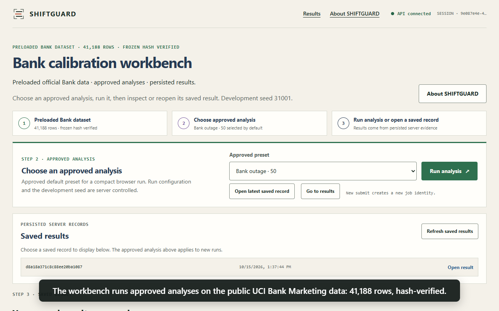
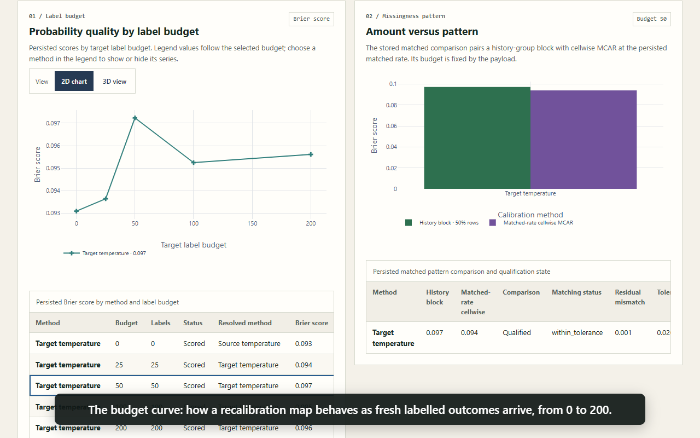
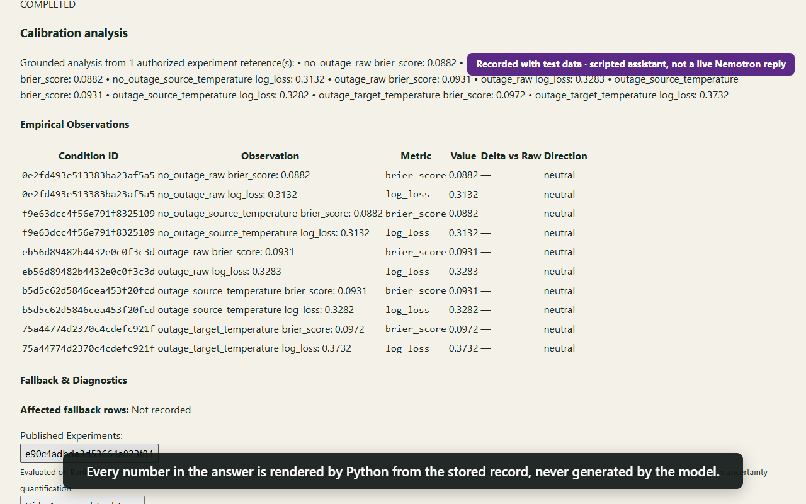
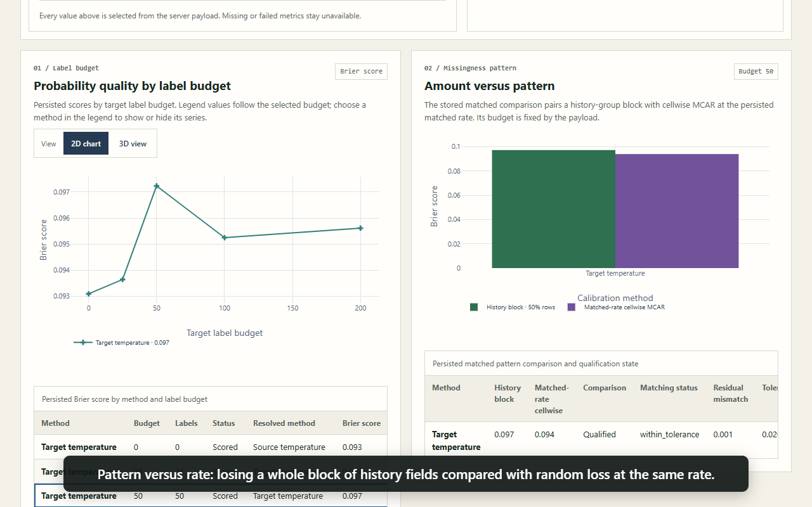

# SHIFTGUARD

**When a model's inputs go missing, are its probabilities still trustworthy?**
SHIFTGUARD rehearses input-field outages on a tabular model and measures what happens to
calibration and decision quality, and how many fresh labelled outcomes it takes to recover.

Built for the Nebius × NVIDIA hackathon. The assistants run NVIDIA Nemotron on Nebius Token
Factory. Every number the app shows is read from a stored, hash-verified record, never
generated by the model.

## The problem

A deployed scoring model keeps returning probabilities after an upstream field disappears:
a data feed breaks, a schema changes, a customer withdraws consent. Whether the model still
*ranks* well and whether its probabilities still *match real outcome rates* are separate
questions. Teams that act on thresholds (credit, fraud, outreach, triage queues) can make
worse decisions without noticing.

## Who it is for

- **ML engineers and data scientists with tabular models.** Rehearse a field outage before
  it happens: random cell loss, loss of a whole block of history fields, or random loss
  matched to the same rate. See how calibration and decision loss move, and how many new
  labels recalibration needs (the budget curve).
- **Analytics teams that act on probability thresholds.** The decision-loss and reliability
  views show whether a score is still safe to act on, separately from whether it still ranks.
- **Researchers.** A reproducible benchmark harness: 400 paired conditions, every failure and
  fallback counted, a label firewall and content-hashed artifacts. New calibration methods
  can be compared on equal terms.
- **People building LLM features.** Tested patterns you can reuse: an assistant restricted to
  approved tools whose numbers are rendered by Python; a hard daily spend ledger (reserve
  before each call, no retries, halt when an outcome is unknown); at-most-once chat replies
  that survive reloads; a single-owner lock so two servers cannot both spend.
- **Students and teachers.** A hands-on way to see why Brier score and log loss can disagree,
  and why a missingness *pattern* matters, not just its *rate*.

## What it shows

On the public [UCI Bank Marketing](https://archive.ics.uci.edu/dataset/222/bank+marketing)
data (41,188 rows):

- **Controlled feature loss:** random cells at 10% and 30%, removal of the history block for
  half the rows, and random cells matched to that block's realized removal rate.
- **Eight calibration conditions** on two frozen predictors (logistic regression and random
  forest) at label budgets of 0, 25, 50, 100 and 200: raw scores; three source-only
  temperature maps (plain, re-masked, fraction-binned); and target temperature, Platt, Beta and
  isotonic maps fitted on the new labels. That is 400 scored conditions, each linked to its
  exact data, split, mask and fit.
- **Views for every saved run:** reliability curves, budget curves, decision loss, pattern
  versus rate, fallback details, and an identity and provenance panel with content hashes.
- **Two Nemotron assistants.** The *Results assistant* may only call a closed set of read and
  run tools, and the app renders every figure from the stored record; its tool trace is shown.
  *General chat* is tool-free and labelled unverified.

What the development run found (single seed): at 50 target labels, the temperature, Platt and
Beta maps lower mean Brier score against a zero-label source comparator in 4 of 8 shifted
cells each, but raise log loss in all 8. The answer depends on the metric, and the app reports
the adverse results too.

## Screenshots

| Workbench | Budget curve |
|---|---|
|  |  |
| **Results assistant** (scripted test harness) | **Pattern versus rate** |
|  |  |

A 2-minute captioned walkthrough, recorded against the scripted local harness, is in
[docs/submission/media/shiftguard-demo.webm](docs/submission/media/shiftguard-demo.webm).

## Quickstart

Needs Python 3.13 and [uv](https://docs.astral.sh/uv/). The built frontend is committed, so
Node.js is not needed to run the app. The first `uv sync` downloads about 150 MB of packages;
after that, setup takes a minute and the **bank-baseline** analysis finishes in seconds.

```bash
git clone https://github.com/The-Abhinav-Anand/shiftguard.git
cd shiftguard
uv sync --locked
cp .env.example .env                     # local SQLite; both assistants off
uv run python scripts/download_datasets.py --dataset bank --cache none.zip \
  --clean-output var/datasets/bank-additional-full.csv \
  --run-manifest-output var/datasets/bank-marketing.manifest.json
uv run shiftguard status                 # creates the database at the latest schema
SHIFTGUARD_EMBEDDED_WORKER=true uv run uvicorn shiftguard.api.main:app --port 8000
```

On Windows PowerShell, set the worker flag with `$env:SHIFTGUARD_EMBEDDED_WORKER = "true"`
before the last command.

Open <http://127.0.0.1:8000>, pick an approved analysis (for example **bank-baseline**) and
press **Run analysis**. The job runs in the background; open it under **Saved results**.
The download step fetches the official UCI archive and refuses it unless every SHA-256 in
[`data/manifests/bank.json`](data/manifests/bank.json) matches.

To try the assistants, add `NEBIUS_API_KEY` to `.env` and set
`SHIFTGUARD_AGENT_ENABLED=true` and/or `SHIFTGUARD_GENERAL_CHAT_ENABLED=true`. Model use is
capped at 50 calls and 100,000 tokens per UTC day.

Hosting it on a server with HTTPS: see [`deploy/README.md`](deploy/README.md) (one command on
an Ubuntu VM).

## Architecture

```
Browser (React + TypeScript + Plotly, served by the API)
   │  /api/v1, private session token per browser
   ▼
FastAPI app ── one process owns model dispatch ──► Nebius Token Factory (Nemotron)
   │   ├─ jobs: durable, idempotent submissions          ▲ daily ledger: reserve before
   │   ├─ results: published, hash-verified artifacts    │ each call, zero retries
   │   └─ assistants: approved tools only ───────────────┘
   ▼
PostgreSQL 16 (hosted) or SQLite (local) ◄── experiment worker (separate process)
                                                  │ outage → recalibrate → evaluate
                                                  ▼
                                          artifact store (content-hashed files)
```

| Area | Where |
|---|---|
| Data contracts and cleaning | `shiftguard/datasets/`, `data/manifests/` |
| Missingness mechanisms | `shiftguard/missingness/` |
| Predictors and calibration maps | `shiftguard/predictors/`, `shiftguard/calibration/` |
| Metrics and the label firewall | `shiftguard/metrics/`, `shiftguard/experiments/` |
| Jobs, worker and storage | `shiftguard/jobs/`, `shiftguard/storage/`, `alembic/` |
| API and assistants | `shiftguard/api/`, `shiftguard/agent/` |
| Frontend | `frontend/` (build output in `shiftguard/static/`) |
| Deployment | `Dockerfile`, `deploy/` |

## Honest limits

- **Bank Marketing data only.** Uploading your own data is not supported; see
  [docs/ADAPTING.md](docs/ADAPTING.md) for what adapting it to another dataset involves.
- **Single-seed development results**, one evaluation partition, no confidence intervals or
  significance tests. Nothing here is a confirmatory or peer-reviewed finding.
- **Not a new calibration algorithm.** It compares established maps under controlled shift.
- The multi-seed repeat engine and the Adult Income adapter are built and tested on
  fabricated data only. They are not run on real outcomes and not exposed in the app.
- The shared model allowance can run out on a busy day. The assistants then say so; runs,
  saved results and charts keep working.

The mapping from every public claim to its evidence is in
[docs/submission/CLAIMS_AND_EVIDENCE.md](docs/submission/CLAIMS_AND_EVIDENCE.md).

## Tests

```bash
uv sync --locked --extra test
uv run pytest -q
```

PostgreSQL cases run when `SHIFTGUARD_TEST_POSTGRES_URL` points at a disposable PostgreSQL 16
database; otherwise they are skipped. Browser specs live in `tests/e2e/` and run with
Playwright from `frontend/` (`npx playwright test --config playwright.config.ts`).

## Documentation

[docs/README.md](docs/README.md) indexes the user guides and the engineering log (the gate,
review and correction records written while building this).

## License

Apache-2.0; see [LICENSE](LICENSE) and [THIRD_PARTY_NOTICES.md](THIRD_PARTY_NOTICES.md).
The Bank Marketing dataset is CC BY 4.0 (Moro, Rita and Cortez, 2014, DOI 10.24432/C5K306) and is downloaded at
setup, not distributed here. To cite SHIFTGUARD, see [CITATION.cff](CITATION.cff).
