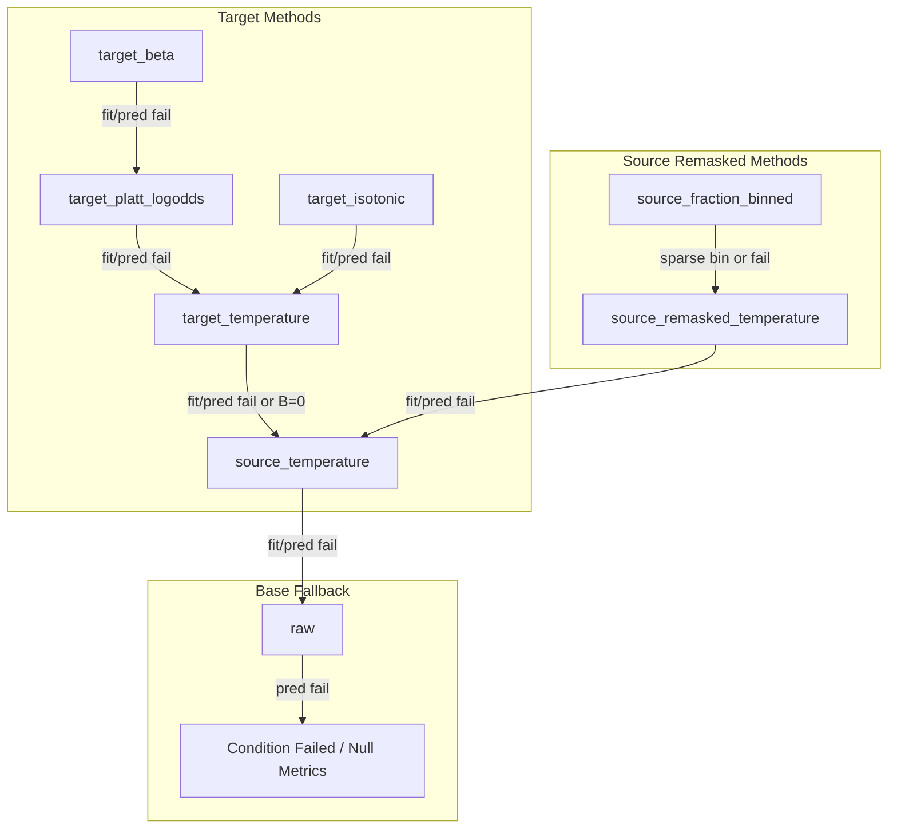

# SHIFTGUARD Gate 3 Bounded Development Contract
**Protocol version:** `sg-protocol-1.0-draft-gate3`
**Date:** 16 September 2026
**Status:** FROZEN DEVELOPMENT CONTRACT (Phase 3A)
**Active writer:** `gemini_antigravity`
**Base checkpoint:** `c9cc001b3c76d24cbc1aecc0afb963b6ceb7ebbf` (accepted source: `937f33c5c0f96ca18c9e7e0a82769c430d71bfa1`)

---

## 1. Executive Summary & Purpose

This document establishes the binding implementation contract for SHIFTGUARD Gate 3: the Full Primary Development Stress Engine. It declares all numerical parameters, random seed namespaces, access boundaries, fallback cascades, evaluation metrics, and acceptance mappings before experimental code execution.

All choices herein inherit from the approved hackathon execution plan (`docs/aegis/plans/2026-09-10-shiftguard-hackathon-execution-plan.md`) and the technical execution blueprint (`SHIFTGUARD_Implementation_Blueprint_v2_2026-09-09.md`).

---

## 2. Section A: Configuration

### 2.1 Predictor Models & Preprocessing
Gate 3 supports two primary classifiers fit exclusively on the predictor-training partition (55% of Bank data):

1. **Logistic Regression (`logistic_regression`)**:
   - **Preprocessing**:
     - Numeric features (`age`, `pdays`, `previous`): median imputation via `SimpleImputer(strategy="median")` followed by `StandardScaler()`.
     - Categorical features (remaining 7 features): missing sentinel `__SHIFTGUARD_MISSING__` followed by `OneHotEncoder(handle_unknown="ignore")`.
   - **Model Hyperparameters**: `LogisticRegression(C=1.0, max_iter=1000, solver="lbfgs", random_state=seed_model)`.
   - Frozen from Gate 1 and Gate 2.

2. **Random Forest (`random_forest`)**:
   - **Preprocessing**:
     - Numeric features: median imputation via `SimpleImputer(strategy="median")` without scaling (tree models are scale-invariant per Blueprint Section 11.5).
     - Categorical features: missing sentinel `__SHIFTGUARD_MISSING__` followed by `OneHotEncoder(handle_unknown="ignore")`.
   - **Model Hyperparameters**: `RandomForestClassifier(n_estimators=100, max_depth=None, min_samples_split=2, min_samples_leaf=1, random_state=seed_model, n_jobs=1)`.
   - `n_jobs=1` is strictly enforced for deterministic cross-platform reproduction.

Neither preprocessor nor predictor may be refitted or updated during calibration or target adaptation.

### 2.2 Missingness Interventions & Scenarios
Missingness is injected exclusively on eligible originally observed raw features before preprocessing:

1. **Baseline (`baseline`)**:
   - Injected missingness: none (natural missingness and structural sentinels preserved).
2. **Cellwise MCAR (`mcar_0_00`, `mcar_0_10`, `mcar_0_30`)**:
   - Evaluated at probabilities $p \in \{0.00, 0.10, 0.30\}$.
   - **Shared Uniform Stream**: A single uniform matrix $U \in [0, 1]^{N \times D_{\text{eligible}}}$ is generated per dataset/partition.
   - For any rate $p$, cell $(i, j)$ is masked if $U_{i, j} < p$.
   - This enforces strict monotone nesting: $\text{Mask}(0.00) \subseteq \text{Mask}(0.10) \subseteq \text{Mask}(0.30)$.
3. **Semantic History Block (`history_block_0_50`)**:
   - Features: `("pdays", "previous", "poutcome")`.
   - Row outage probability: $p_{\text{row}} = 0.50$.
   - If row uniform $u_i < 0.50$, all three features are set to null simultaneously.
4. **Matched Cellwise Comparison (`mcar_matched_history`)**:
   - Realized eligible-cell rate:
     $$r_{\text{realized}} = \frac{\text{newly missing eligible cells}}{\text{total observed eligible cells}}$$
   - Cellwise MCAR is generated with Bernoulli probability $p = r_{\text{realized}}$ to directly isolate pattern impact (block vs cellwise) from missingness volume.
   - Strategy is declared as `bernoulli_matched_rate`.
   - Matching status is explicitly recorded as `exact_match` (residual == 0), `within_tolerance` (residual $\le 0.02$), `outside_tolerance` (residual $> 0.02$), or `impossible` (invalid denominator/rate).
   - Both requested rate, realized rate (numerator/denominator), matching strategy (`bernoulli_matched_rate`), tolerance ($0.02$), matching status, comparison qualification (`comparison_qualified`), and residual mismatch $|r_{\text{cellwise}} - r_{\text{block}}|$ are explicitly persisted.
   - Comparisons are marked `comparison_qualified: false` if outside tolerance or impossible.

### 2.3 Budget Grid & Independent Seed Namespaces
- **Target Label Budgets**: $B \in \{0, 25, 50, 100, 200\}$.
- **Development Seeds**: $31001$ (primary development seed), $31002$, $31003$.
- **Independent Seed Namespaces** (derived deterministically from `master_seed` via `np.random.SeedSequence`):
  - `split`: outer dataset role partitioning (55/15/10/20).
  - `model`: predictor initialization and fitting.
  - `source_remask`: generation of simulated masks on source calibration data.
  - `pool_mask`: masking of the unlabeled target pool before acquisition.
  - `test_mask`: masking of final evaluation test records.
  - `acquisition`: deterministic label-blind permutation of target pool IDs.

### 2.4 Eight Calibration Conditions
Every experiment condition is identified by one of eight explicit method keys:

| Condition Key | Calibration Family | Data Read | Target Labels Consumed |
|---|---|---|---|
| `raw` | Frozen predictor baseline | None | 0 |
| `source_temperature` | Single positive scalar $T_{\text{source}} > 0$ | Source calibration rows (unmasked) | 0 |
| `source_remasked_temperature` | Global temperature $T_{\text{remask}} > 0$ | Source calibration rows (remasked) | 0 |
| `source_fraction_binned_temperature` | 10 bin temperatures $T_b > 0$ | Source calibration rows (remasked, binned) | 0 |
| `target_temperature` | Single positive scalar $T_{\text{target}} > 0$ | Acquired target prefix (masked) | Budget $B$ |
| `target_platt_logodds` | 2-parameter logistic map | Acquired target prefix (masked) | Budget $B$ |
| `target_beta` | 3-parameter Beta calibration | Acquired target prefix (masked) | Budget $B$ |
| `target_isotonic` | Nonparametric isotonic regression | Acquired target prefix (masked) | Budget $B$ |

### 2.5 Calibration Optimizer & Mathematical Formulations
- **Probability Clipping**: $\epsilon = 10^{-15}$. All input probabilities $p$ are clipped to $[\epsilon, 1 - \epsilon]$.
- **Temperature Scaling**:
  - Predictor log-odds $z = \log(p / (1 - p))$. Calibrated probability $\sigma(z / T)$.
  - Objective: negative log-likelihood with constraint $T > 0$.
- **Platt Log-Odds**:
  - 1D feature $x = \text{logit}(p) = \log(p / (1 - p))$.
  - Logistic regression fit: $\sigma(a \cdot x + b)$ via `LogisticRegression(C=1.0, solver="lbfgs", max_iter=1000)`.
- **Beta Calibration** (Kull et al., 2017):
  - 2D features: $x_1 = \log(p)$, $x_2 = -\log(1 - p)$.
  - Map: $\sigma(a \cdot x_1 + b \cdot x_2 + c)$ subject to $a \ge 0, b \ge 0$.
  - Implemented via bounded optimization (L-BFGS-B on NLL) or L2-regularized logistic formulation.
- **Isotonic Regression**:
  - `IsotonicRegression(out_of_bounds="clip", y_min=0.0, y_max=1.0)`.
  - Serves as a small-sample diagnostic baseline ($B \le 200$).
- **Source Remasked Calibration**:
  - Source rows are replicated across simulated missingness patterns (rates 0.0, 0.1, 0.3, 0.5) drawn from the declared missingness distribution without reading target outcomes.
- **Source Fraction-Binned Temperature**:
   - Binning variable: newly injected missingness fraction $f = \text{newly missing eligible features} / \text{eligible feature count} \in [0, 1]$.
   - Inference uses the exact newly injected missingness fraction (not total missingness, which would misroute natural missingness).
   - 10 equal-width bins: $b \in \{0, \dots, 9\}$ corresponding to $[0.0, 0.1), [0.1, 0.2), \dots, [0.9, 1.0]$.
   - Bin assignment: $\min(9, \lfloor 10 \cdot f \rfloor)$.
   - A positive scalar temperature $T_b > 0$ is fit per bin on source-remasked data.
   - If a bin has fewer than 10 samples or only 1 class or fails optimization: sparse bins execute the actual object fallback chain: `sparse_fraction_bin` $\to$ `source_remasked_temperature` $\to$ `source_temperature` $\to$ `raw` without fabricating temperature 1.0. Per-bin support, fallback reason, resolved map, and affected-row counts are persisted.
   - Raw probabilities are validated for shape, row count, finiteness, bounds $[0, 1]$, and row normalization ($p_0 + p_1 = 1.0 \pm 10^{-4}$) before clipping. NaN, inf, or out-of-range values trigger prediction failure rather than silent clipping.

### 2.6 Decision Loss & Cost Grid
- Decision threshold: $\tau = \frac{C_{\text{FP}}}{C_{\text{FP}} + C_{\text{FN}}}$.
- Binary classification: $\hat{y} = \mathbb{I}(p \ge \tau)$.
- Normalized decision loss:
  $$\mathcal{L}_{\text{decision}} = \frac{C_{\text{FP}} \cdot \text{FP} + C_{\text{FN}} \cdot \text{FN}}{N}$$
- **Predeclared Cost Pairs $(C_{\text{FP}}, C_{\text{FN}})$**:
  1. $(1.0, 1.0) \implies \tau = 0.50$ (symmetric)
  2. $(1.0, 4.0) \implies \tau = 0.20$ (high FN cost)
  3. $(1.0, 9.0) \implies \tau = 0.10$ (extreme FN cost / screening)
  4. $(4.0, 1.0) \implies \tau = 0.80$ (high FP cost)
  5. $(9.0, 1.0) \implies \tau = 0.90$ (extreme FP cost / precision focus)

Costs and thresholds are fixed prior to evaluation and never tuned post-hoc.

---

## 3. Section B: Access Boundaries & Information Flow

Strict information firewalls prevent data leakage:

1. **Predictor Training (55% role)**:
   - Reads only training rows and training labels.
   - Preprocessing transforms and predictor parameters are frozen upon fit completion.
2. **Source Calibration (15% role)**:
   - Reads only source calibration rows and source calibration labels.
   - Source remasking operates strictly on source calibration data.
   - Target labels consumed: exactly 0.
3. **Target Pool (10% role)**:
   - Contains 4,119 rows for Bank Marketing.
   - The entire target pool has scenario missingness applied *before* label acquisition.
   - Acquisition reveals labels in a strictly label-blind order: `permutation = rng_acq.permutation(pool_ids)`.
   - Never inspects pool labels during ordering.
   - Never redraws, expands, or replaces prefixes due to class imbalance.
4. **Target Calibration Fitting**:
   - Reads only the revealed prefix of rows and labels of length $B$.
   - If $B = 0$: no target calibration fit is attempted.
5. **Evaluation / Final Test (20% role)**:
   - Final test labels reside exclusively inside `FinalTestEvaluator`.
   - Evaluator receives only predicted probability arrays.
   - No fitting, scenario selection, threshold tuning, or hyperparameter selection may read evaluation labels.

---

## 4. Section C: Failure Semantics & Fallback Cascades

All calibration methods follow a deterministic fallback cascade resolved *before* scoring:

### Specific Failure Rules:
1. **Budget Zero ($B = 0$)**: Consumes 0 target labels; target methods immediately resolve to their fallback (`source_temperature` or `source_remasked_temperature`) with `labels_consumed=0`.
2. **One-Class or Empty Prefix**: If the acquired prefix has $< 2$ distinct classes, fitting is marked `not_fitted` with `fallback_reason="one_class_or_empty"`. No redraw occurs.
3. **Sparse Fraction Bin**: If bin $b$ in fraction-binned calibration lacks $\ge 10$ samples or contains only 1 class, `fallback_reason="sparse_fraction_bin"` is recorded and predictions use `source_remasked_temperature`.
4. **Degenerate or Nonfinite Outputs**: Any NaN, $\pm\infty$, or out-of-bound probabilities trigger an immediate fallback to the predecessor method.
5. **Raw Prediction Failure**: If even raw predictor predictions fail on evaluation rows, the condition is marked `failed` with null metrics. All comparisons involving failed conditions report `available=false`.
6. **Failure Counting**: Fit failures are counted per unique calibrator object; prediction failures are counted per prediction attempt. Source fallback reuse in multiple conditions is tracked without double-counting.

---

## 5. Section D: Acceptance Mapping & Verification Matrix

Every requirement and invariant is mapped to an implementation owner, a verification test, and persisted evidence:

| Invariant / Requirement | Owning Module | Test / Verification Check | Persisted Field |
|---|---|---|---|
| Random Forest deterministic predictor | `shiftguard/predictors/random_forest.py` | `tests/unit/test_random_forest.py` | `predictor.model_type`, `predictor_id` |
| MCAR missingness & monotone nesting | `shiftguard/missingness/mcar.py` | `tests/unit/test_matched_missingness.py` | `masks.full_pool.rates`, `masks.test.rates` |
| Matched missing-rate reporting | `shiftguard/missingness/mcar.py` | `tests/unit/test_matched_missingness.py` | `metadata.matched_rate_comparison` |
| Label-blind nested prefixes (0-200) | `shiftguard/protocol/acquisition.py` | `tests/unit/test_acquisition_prefix.py` | `acquisition.order`, `acquisition.consumed_labels` |
| Platt log-odds calibration | `shiftguard/calibration/platt_logodds.py` | `tests/unit/test_platt_logodds.py` | `conditions.*.calibration.requested_method` |
| Beta calibration | `shiftguard/calibration/beta.py` | `tests/unit/test_beta_calibration.py` | `conditions.*.calibration.requested_method` |
| Source remasking & fraction-binned | `shiftguard/calibration/fraction_binned.py` | `tests/unit/test_fraction_binned_fallback.py` | `conditions.*.calibration.fallback_reason` |
| Brier (half-scaled) & log-loss (1e-15) | `shiftguard/metrics/probability.py` | `tests/unit/test_probability_metrics.py` | `metrics.brier_score`, `metrics.log_loss` |
| Reliability (10-bin) & ECE | `shiftguard/metrics/reliability.py` | `tests/unit/test_reliability_metrics.py` | `metrics.reliability`, `metrics.ece` |
| Ranking: AUROC & Average Precision | `shiftguard/metrics/ranking.py` | `tests/unit/test_ranking_metrics.py` | `metrics.roc_auc`, `metrics.average_precision` |
| Decision loss across cost grid | `shiftguard/metrics/decision.py` | `tests/unit/test_decision_loss.py` | `metrics.decision_loss` |
| 4 persisted UI-ready payloads | `shiftguard/experiments/stress_runner.py` | `tests/integration/test_bank_stress_payloads.py` | `var/artifacts/<exp_id>/payloads/*.json` |
| Adult train-only acquisition & test seal | `shiftguard/datasets/adult.py` | `tests/unit/test_adult_development_owner.py` | `data/manifests/adult.json`, `configs/adult-confirmatory.yaml` |
| Clean 3-way reproduction (SQLite/Postgres) | `verification/verify_gate3_reproduction.py` | Reproduction script run | `verification/gate3/reproduction-summary.json` |

---

## 6. Section E: Adult Dataset Ownership & Seal Contract

1. **Acquisition Boundary**:
   - Official UCI URL: `https://archive.ics.uci.edu/static/public/2/adult.data`.
   - `adult.data` contains 32,561 rows.
   - The confirmatory test file `adult.test` (16,281 rows) is **strictly forbidden** from being downloaded, stored, inspected, or scored in Gate 3.
2. **Schema & Cleaning**:
   - Features: 14 raw predictors (age, workclass, fnlwgt, education, education-num, marital-status, occupation, relationship, race, sex, capital-gain, capital-loss, hours-per-week, native-country).
   - Natural missing markers `?` are converted to null/sentinel.
   - `education` and `education-num` redundancy is handled deterministically (drop `education`, retain `education-num`).
   - Labels: binary `income` (`<=50K` -> 0, `>50K` -> 1).
3. **Partition Allocation**:
   - `adult.data` is split into:
     - Predictor train: 68.75%
     - Source calibration: 18.75%
     - Target pool: 12.50%
     (Normalized 55:15:10 proportions within training data).
4. **Confirmatory Seal**:
   - Configuration `configs/adult-confirmatory.yaml` contains an explicit execution guard raising `RuntimeError("Adult confirmatory execution is sealed until Gate 8 protocol lock.")`.
   - Tested via synthetic test-label fixtures that normalize trailing periods without opening `adult.test`.
