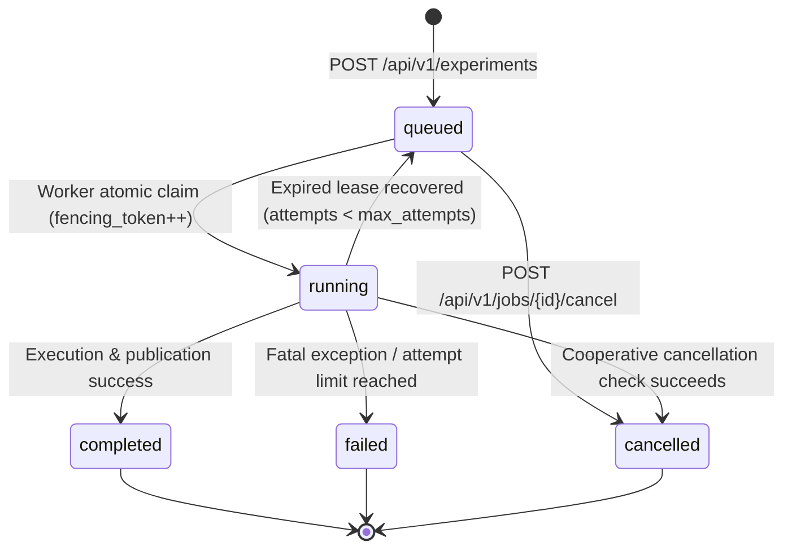

# SHIFTGUARD Gate 4 Runtime Contract

**Version:** 1.0.0  
**Effective Date:** 17 September 2026  
**Status:** ACTIVE  
**Parent Blueprint:** SHIFTGUARD Implementation Blueprint v2 (Gate 4)  
**Governing Documents:** `docs/aegis/reviews/2026-09-17-codebase-audit/EXECUTION_PLAN.md` (Sections 8, 9, 10)

---

## 1. Scope and Architecture

Gate 4 establishes the durable asynchronous execution engine and typed REST API for SHIFTGUARD. It decouples the HTTP request/response cycle from scientific fitting loops through a transactional job queue, atomic worker claims with fencing tokens, heartbeated leases, crash-safe publication recovery, strict schema validation, and durable agent session continuation.



---

## 2. Job Queue State Graph & Lifecycle Invariants

### 2.1 States
- `queued`: Job created and committed in database; waiting for worker claim. Eligible for immediate cancellation.
- `running`: Claimed by an active worker holding valid lease and unique fencing token. Heartbeat refreshed periodically.
- `completed`: Scientific computation finished, manifest validated, and artifacts published to `<artifact_root>/<experiment_id>`. Terminal state.
- `failed`: Terminal state following unrecoverable error or retry exhaustion. Sanitized error details recorded in job record.
- `cancelled`: Cooperatively cancelled while queued or during execution checkpoints. Terminal state.

### 2.2 Invariants
1. **Durable Admission Before 202:** Every `POST /api/v1/experiments` commits the `jobs` row to the database before returning `202 Accepted` with `job_id`, `status_url`, and `estimated_duration_seconds`.
2. **Atomic Worker Claim:**
   - **SQLite:** Executed within `BEGIN IMMEDIATE` transaction, ordering by priority DESC, created_at ASC, id ASC, with conditional `UPDATE ... RETURNING`.
   - **PostgreSQL:** Executed via `SELECT ... FOR UPDATE SKIP LOCKED` followed by update within the same transaction.
   - Competing workers never claim the same job attempt.
3. **Fencing Tokens:**
   - On every claim, `attempt` is incremented and a monotonically increasing or fresh UUID `fencing_token` is issued.
   - All heartbeat, progress updates, cancellation checks, and final publications require matching `(job_id, fencing_token, "running")`.
   - A superseded or zombie worker holding an old token is rejected and fenced out immediately.
4. **Leases and Heartbeat:**
   - Default lease duration: `90 seconds` (injectable in tests).
   - Default heartbeat interval: `30 seconds` (injectable in tests).
   - Heartbeat runs in an independent thread using its own short-lived database connection. Never share database connections across threads.
5. **Cooperative Cancellation:**
   - Evaluated between scenarios, budgets, calibration methods, and immediately prior to artifact publication.
   - If a cancellation request was accepted (`cancel_requested = True`), worker aborts execution, sets status to `cancelled`, and cleans up staging artifacts.
   - If a job has already completed, cancellation returns `409 Conflict`.
6. **Retry Classification:**
   - Transient operational errors (e.g. temporary SQLite busy / connection drop) increment `attempt` and return job to `queued` if `attempt < max_attempts` (default 3).
   - Protocol, configuration, or identity errors are classified as terminal `failed` without retry.

---

## 3. Database Schema (Migration 0005)

### 3.1 `jobs` Table
- `id` (VARCHAR(36) PRIMARY KEY): Job UUID.
- `experiment_id` (VARCHAR(24) NULLABLE): Computed or associated experiment ID.
- `session_id` (VARCHAR(36) NULLABLE): Associated agent session ID.
- `idempotency_key` (VARCHAR(128) NULLABLE UNIQUE): Scoped client idempotency key.
- `payload_hash` (VARCHAR(64) NOT NULL): SHA-256 digest of normalized request parameters.
- `status` (VARCHAR(20) NOT NULL): `queued`, `running`, `completed`, `failed`, `cancelled`.
- `request_params_json` (TEXT NOT NULL): Complete validated request parameters.
- `worker_id` (VARCHAR(64) NULLABLE): Identifier of current claim worker.
- `fencing_token` (VARCHAR(36) NULLABLE): Active lease fencing token.
- `attempt` (INTEGER NOT NULL DEFAULT 0): Number of claims made.
- `max_attempts` (INTEGER NOT NULL DEFAULT 3): Maximum allowable execution attempts.
- `lease_expires_at` (TIMESTAMP NULLABLE): Expiry timestamp for current worker lease.
- `heartbeat_at` (TIMESTAMP NULLABLE): Last recorded heartbeat timestamp.
- `cancel_requested` (BOOLEAN NOT NULL DEFAULT FALSE): Flag indicating cancellation requested.
- `error_json` (TEXT NULLABLE): Sanitized error envelope if failed.
- `result_json` (TEXT NULLABLE): Result summary if completed.
- `created_at` (TIMESTAMP NOT NULL): Enqueue timestamp.
- `started_at` (TIMESTAMP NULLABLE): Initial claim timestamp.
- `completed_at` (TIMESTAMP NULLABLE): Terminal transition timestamp.

### 3.2 `job_events` Table
- `id` (INTEGER PRIMARY KEY AUTOINCREMENT / SERIAL): Event sequence ID.
- `job_id` (VARCHAR(36) NOT NULL REFERENCES jobs(id)): Foreign key.
- `event_type` (VARCHAR(32) NOT NULL): `ENQUEUED`, `CLAIMED`, `HEARTBEAT`, `CANCEL_REQUESTED`, `CANCELLED`, `COMPLETED`, `FAILED`, `REQUEUED`.
- `fencing_token` (VARCHAR(36) NULLABLE): Associated fencing token.
- `details_json` (TEXT NULLABLE): Event-specific metadata.
- `created_at` (TIMESTAMP NOT NULL): Event timestamp.

### 3.3 `agent_sessions` Table
- `id` (VARCHAR(36) PRIMARY KEY): Session UUID.
- `status` (VARCHAR(32) NOT NULL): `ACTIVE`, `WAITING_FOR_JOB`, `COMPLETED`, `FAILED`.
- `active_nonce` (VARCHAR(64) NOT NULL): Server-issued single-use continuation nonce.
- `required_job_ids_json` (TEXT NOT NULL): Array of job IDs blocking continuation.
- `state_json` (TEXT NOT NULL): Internal session context / conversation state.
- `result_json` (TEXT NULLABLE): Final result payload.
- `created_at` (TIMESTAMP NOT NULL): Session creation timestamp.
- `updated_at` (TIMESTAMP NOT NULL): Last state transition timestamp.

### 3.4 `idempotency_records` Table
- `key` (VARCHAR(128) PRIMARY KEY): Scoped idempotency key.
- `payload_hash` (VARCHAR(64) NOT NULL): Request payload SHA-256 hash.
- `job_id` (VARCHAR(36) NOT NULL REFERENCES jobs(id)): Associated job ID.
- `response_code` (INTEGER NOT NULL): HTTP status code returned (202).
- `response_json` (TEXT NOT NULL): Cached response payload.
- `created_at` (TIMESTAMP NOT NULL): Record timestamp.

---

## 4. API Endpoints Contract

All endpoints follow strict Pydantic parsing with `extra="forbid"`. Error envelopes adhere strictly to:
```json
{
  "error": {
    "code": "ERROR_CODE",
    "message": "Human-readable sanitized message",
    "request_id": "req-uuid",
    "details": {}
  }
}
```

### 4.1 Health & Liveness
- `GET /health/live`: Process liveness. Returns `{"status": "ok"}` with 200.
- `GET /health/ready`: Dependency readiness. Validates database connectivity and artifact directory writable. Returns 200 or 503.

### 4.2 Metadata (Presets Only)
- `GET /api/v1/datasets`: Approved dataset identifiers (`bank`, `adult_train`). No raw rows or labels.
- `GET /api/v1/datasets/{id}`: Dataset metadata, record counts, and feature summaries.
- `GET /api/v1/models`: Allowed predictor models (`logistic_regression`, `random_forest`).
- `GET /api/v1/scenarios`: Allowed shift/missingness scenarios.

### 4.3 Experiment Job Submission
- `POST /api/v1/experiments`
  - Header: `Idempotency-Key` (optional, string <= 128 chars).
  - Body: Strict preset config (e.g. `preset_name: "bank-outage-50"` or `"bank-stress"`).
  - Validates quota (max 2 active jobs per session).
  - Returns **202 Accepted**:
    ```json
    {
      "job_id": "uuid",
      "status": "queued",
      "status_url": "/api/v1/jobs/uuid",
      "estimated_duration_seconds": 60
    }
    ```
  - Replay with identical key & payload returns cached 202.
  - Replay with identical key but mismatched payload returns **409 Conflict**.

### 4.4 Job Inspection & Cancellation
- `GET /api/v1/jobs/{id}`: Returns job status, attempts, lease state, result/error linkage.
- `POST /api/v1/jobs/{id}/cancel`:
  - If `queued`: immediately transitions to `cancelled` and marks unclaimable. Returns 202.
  - If `running`: sets `cancel_requested = True`. Returns 202.
  - If `completed` or `failed`: returns **409 Conflict** (`JOB_ALREADY_TERMINAL`).

### 4.5 Experiment Results & Artifact Downloads
- `GET /api/v1/experiments/{id}`: Published experiment summary and condition overview.
- `GET /api/v1/experiments/{id}/metrics`: Structured evaluation metrics across conditions.
- `GET /api/v1/experiments/{id}/artifacts`: Manifest of published artifacts with download links.
- `GET /api/v1/experiments/{id}/artifacts/{name}`: Serves artifact JSON. Path traversal strictly forbidden (resolves name against approved manifest only).

### 4.6 Agent Session Continuation
- `GET /api/v1/agent/sessions/{id}`: Session history and pending job dependencies.
- `POST /api/v1/agent/sessions/{id}/resume`:
  - Requires `nonce` matching `active_nonce`.
  - If required jobs are still pending: returns 202 Accepted with status `WAITING_FOR_JOB`.
  - If all required jobs completed: evaluates terminal status, records exactly one completion transition, invalidates nonce, issues new nonce, and returns 200 OK.
  - Idempotent: repeated calls with same state return same transition result.
