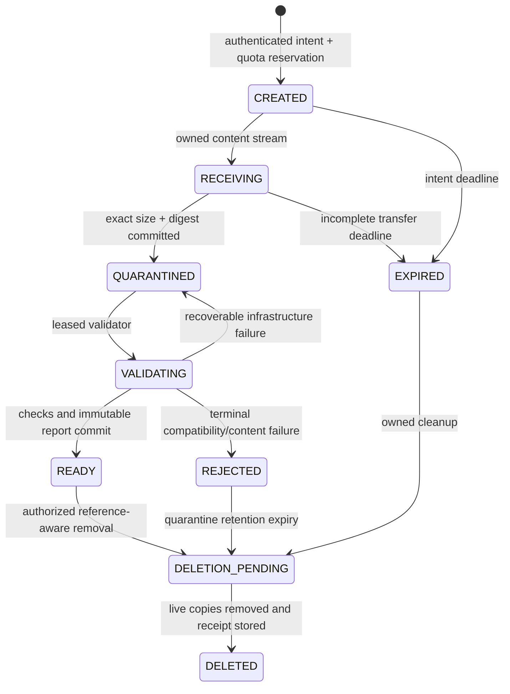

# SHIFTGUARD private business datasets and frozen models

Complete architecture, failure contracts and large-batch execution plan. **Created 30 September 2026; completed and refreshed 1 October 2026. Status: PLAN_COMPLETE; implementation NOT_STARTED.**

## 1. Outcome and current boundary

A business will create a private workspace, register its already-trained model and held-out labeled datasets, validate their compatibility, declare missing-input scenarios and decision costs, run a bounded calibration comparison, and inspect private persisted evidence. The predictor and its preprocessing remain frozen. SHIFTGUARD will not silently retrain the business model or promise that calibration improves it.

The existing API in `shiftguard/api/schemas.py` accepts only `bank-baseline`, `bank-outage-50` and `bank-stress`; the worker loads approved Bank inputs and trains internal predictors. Published benchmark result/artifact GETs in `shiftguard/api/routes/experiments.py` are public. Those readers must never discover private business results. A browser upload button alone cannot supply the required private storage, authorization, model execution or scientific contract.

This extension is a separately versioned **BYO-v1 private assessment** track. It does not weaken the original blueprint's preset-only public demo or rewrite accepted Gates 0–5. Gate 6's initial [review](../gate6-review.md) recorded 25 blockers and remains historical evidence. The 1 October [independent correction review](../gate6-correction-review-20261001.md) confirms three corrected controls and 22 remaining original findings. [AG-G6-CORRECTIONS-02](../gate6-corrections-02.md) owns that overlapping source work; the author's earlier closure claims are not parent acceptance. Complete the applicable correction review and release writer ownership before changing shared owners. Live Nemotron evidence is not a prerequisite for the new manual private workflow; the original Gate 6 acceptance still requires its own authorized evidence.

Planning basis: the user's request for safe business dataset/model input; [project history and system map](project-history-and-system-map.md); actual API, worker, calibration, metric and migration owners. This document supplies the missing private contracts and acceptance criteria. Provider/account, hosting and customer data remain external prerequisites for execution, not blockers to completing this plan.

## 2. Supported first release

| Surface | BYO-v1 contract | Explicit unavailable behavior |
| --- | --- | --- |
| Task | Binary probabilistic classification on bounded tabular data | Multiclass, regression, text/image models and arbitrary executable workflows return unsupported-task errors. |
| Datasets | Three UTF-8 CSV files: source calibration, target label pool, final evaluation; same feature schema and class mapping | No archives, Excel, Parquet, SQL connections or remote URL fetch in v1. |
| Model | One self-contained ONNX graph containing frozen preprocessing and predictor; only tested runtime/operator profiles | Reject pickle/joblib/cloudpickle, user Python, custom native ops, external tensor files and unapproved graphs. |
| Initial profiles | Fitted scikit-learn logistic and random-forest exports, including the approved numeric or mixed categorical preprocessing profile | Model-family names alone do not prove support. Exact graph, conversion/runtime versions and compatibility tests determine eligibility. |
| Calibration | `raw`, `source_temperature`, `target_temperature`; target budgets `0,25,50` where the pool is large enough | Unsupported methods/budgets are rejected before enqueue, not relabeled or automatically substituted. |
| Scenarios | Baseline, MCAR 0.10, and one user-declared feature-group outage with row probability 0.50; only supported missing encodings | No Bank-specific history fields/sentinels assumed. Scenario ID binds exact feature group and recipe. |
| Cost grid | Existing five pairs `(1,1),(1,4),(1,9),(4,1),(9,1)`, locked before evaluation | Decision loss is weighted cost units, not verified currency savings. Custom financial models require a later contract. |
| Results | Private persisted condition metrics, budget/reliability/decision views, fallback and provenance; context-qualified comparisons | No guaranteed improvement, confirmatory label, live production-monitoring claim or incomplete-condition chart fabrication. |
| Assistant | Disabled for private BYO-v1; manual workflow complete without an LLM | No raw customer rows, labels, paths, ONNX metadata or model parameters go to the current agent/provider. |

Initial resource policy below is a proposed pilot limit, not a measured capacity claim. B0 puts these values in one versioned configuration and B6 verifies actual feasibility before inviting customers. A policy change creates a new policy version and repeats affected load tests; it never expands an in-flight job.

| Limit | Initial value and enforcement owner |
| --- | --- |
| CSV upload | 50 MiB per file; 100,000 total rows across all three roles; at most 100 feature columns and 128 total columns including record/label/optional entity controls and declared excluded metadata |
| Cell / header | 4 KiB encoded cell, 128-byte field name, unique normalized headers; UTF-8 with optional leading BOM, comma delimiter and standard quoted fields |
| Model / metadata | ONNX 25 MiB; JSON manifest 128 KiB; at most 10,000 graph nodes, 10 million declared tensor elements; fully embedded weights |
| Upload handling | Stream in 1 MiB chunks; 60-second idle timeout, 15-minute total transfer limit; server measures bytes regardless of Content-Length |
| Validation | 120-second wall limit, one CPU and 1 GiB memory per parser/model-validation sandbox; failure never enables an asset |
| Inference | CPU-only; chunks of at most 512 rows, 10 seconds per chunk, 2 GiB sandbox memory; 10-minute total assessment deadline |
| Scheduling | Two active assessment jobs per organization, maximum two executing assessments service-wide for initial pilot; organization/session limits enforced transactionally |
| Upload/storage quota | Two concurrent uploads and 1 GiB active asset storage per organization; reserve capacity before accepting bytes |
| Condition grid | At most 27 logical cells for one model, three scenarios, three budgets and three requested methods; unsupported cells rejected or explicitly unavailable by contract |
| Browser report | At most 100 safe validation issues per page and 1,000 issues overall; exact counts retained; no raw cell text in errors |
| Lifetimes | Upload intent 1 hour; abandoned quarantine 24 hours; default ready asset/report retention 30 days; deletion jobs and backup expiry tracked explicitly |

## 3. Business journey and required inputs

1. **Sign in and select an authorized organization.** A verified account is linked to membership. Public demo capability sessions cannot create or access a private organization. Organization selection is checked on the server.
2. **Create a project.** Name it, record the business prediction target and define positive/negative labels. Example: positive means “default within 90 days,” not whichever output column happens to be last. No real customer or regulated deployment claim is inferred from this example.
3. **Register the frozen model.** Upload `model.onnx`, the strict model/schema manifest and a small conversion-parity fixture with expected probabilities. The business exports it locally using its own trusted training environment. SHIFTGUARD never accepts their pickle to perform server-side conversion.
4. **Upload the three held-out datasets.** Each row has an opaque `record_id`, an optional declared `entity_id` for leakage checks, the exact feature columns and `label`. Dates/entities used to prove role separation are metadata columns explicitly excluded from predictor inputs.
5. **Validate mapping and provenance.** Show feature types/order, class orientation, missing representation, schema/model checks, role overlap, observed missingness and disclosed training-overlap evidence. Corrections create new immutable asset versions.
6. **Declare the outage.** Choose one group from the actual model features, never labels/IDs/excluded metadata; select supported scenarios and affordable label budgets. Baseline is mandatory. Show how many pool records a requested budget consumes. No automatic label acquisition from a business system occurs in v1.
7. **Review the frozen assessment recipe.** Bind dataset/model/schema/role/scenario/policy versions, costs, seeds and label access. Display blocking errors, cautions, expected limits and identity. A user confirmation freezes the recipe, not a marketing promise of performance.
8. **Run once under an idempotency key.** Persist intent before request dispatch. A lost response retries the same body/key and returns the same accepted job. A deliberate rerun uses a new execution intent; deterministic content may share a private result while retaining distinct audits.
9. **Inspect evidence.** Explain probability error and decision loss, show raw/source/target comparisons, failed/fallback methods, acquired count and exact provenance. Preserve unfavorable results and qualified/unqualified comparisons.
10. **Export or delete.** Authorized downloads are private and logged. Removal is reference-aware and asynchronous; the UI distinguishes access revoked, live copies removed and retained backup expiration.

Training data are not required for model inference. They are needed only if the business chooses to supply extra provenance proving that evaluation/calibration rows were not used during training. Uploaded test labels are sensitive server-side inputs, never agent/tool/browser payloads.

## 4. Dataset, schema and evaluation contracts

### 4.1 Roles and overlap

`source_calibration` fits the source map; `target_pool` supplies a deterministic label-blind prefix; `final_evaluation` supplies the evaluator's labels. The imported predictor has **no SHIFTGUARD training role**. Do not reuse Bank's 55/15/10/20 split to claim a business model was trained correctly.

Each role must be nonempty. Initial minimums are 50 source-calibration rows and 50 evaluation rows; the largest selected target budget must fit within the pool. Minimums are usability guards, not statistical-power certification. A smaller pool may select only supported budgets that fit; never shrink an accepted budget after execution begins. Source and evaluation one-class datasets remain usable for valid probability metrics but receive `ONE_CLASS_ROLE` qualification; source fitting falls back to raw, and AUROC/AP remain null under the current ranking contract. An acquired one-class prefix falls back without redraw or extra labels.

The server assigns role membership before scoring and persists ordered row IDs and hashes. Reject duplicate `record_id` values within or across files. If an entity key is declared, prevent entity overlap between calibration/pool/evaluation roles for the v1 group-isolation contract. Canonical feature-row fingerprints detect exact repeated content across roles; resolve legitimate collisions explicitly and retain the warning/qualification rather than dropping rows. Neither label-derived ordering nor outcome-guided split repair is permitted.

External model training provenance is `DECLARED`, `PARTIALLY_VERIFIED`, or `VERIFIED_AGAINST_SUPPLIED_TRAINING_MEMBERSHIP`. Model bytes alone cannot prove which rows trained it. Unknown training overlap remains a visible evidence limitation and blocks any “confirmed held-out performance” wording. Do not invent verification from a signed manifest, conversion parity or different random seed.

### 4.2 Schema manifest

Strict JSON with `extra="forbid"`, duplicate-key rejection and finite numeric values. Required fields: `schema_version`, `task`, ordered `features`, control-column definitions, label mapping, missing tokens, encoding, model input binding, scenario eligibility and provenance. Feature entries contain exact CSV name, dtype, ONNX input/index, allowed categorical vocabulary or policy, permitted missing representation and exclusion status. Normalize headers once using declared Unicode NFC rules; retain original byte hashes. Case is significant; duplicate normalized headers are errors.

Illustrative contract, not a claim that this model exists:

```json
{
  "schema_version": "byo-schema-1",
  "task": "binary_classification",
  "record_id_column": "record_id",
  "entity_id_column": null,
  "label_column": "label",
  "label_mapping": {"no_default": 0, "default": 1},
  "features": [
    {"name": "age", "dtype": "float32", "onnx_input": "X", "index": 0,
     "missing_tokens": [""], "missing_representation": "nan"},
    {"name": "balance", "dtype": "float32", "onnx_input": "X", "index": 1,
     "missing_tokens": [""], "missing_representation": "nan"}
  ],
  "excluded_columns": [],
  "training_overlap_status": "DECLARED"
}
```

Require `0` and `1` mapping to two distinct declared label values, exact model positive-column agreement and immutable mapping version. Reject labels that are missing, ambiguous or outside the mapping. Feature booleans, numeric coercions, locale commas, overflow, nonfinite observed values and whitespace handling follow explicit dtype policy. The declared NaN **missing marker** for a graph input is allowed only for a tested imputation path; observed numeric infinity/NaN and output NaN remain invalid. Do not erase strings such as `unknown`, zero, `999` or `nonexistent` unless the customer manifest explicitly assigns that meaning.

CSV parsing must enforce total row/column/cell limits while streaming, exact row width, one header, quoted-field rules and bounded errors. Reject binary/null-byte content, bad encoding, duplicate headers and mismatched required fields. Extra columns are accepted only if declared excluded; no automatic removal of a suspicious label/identifier column without a recorded schema correction. Never call `eval` or execute spreadsheet formulas.

### 4.3 Label firewall

Split feature and label storage at validation. The inference sandbox sees feature tensors and opaque row-order tokens only. Calibration receives source labels and only the revealed target prefix. Scenario generation/acquisition reads features and row identities, not pool labels. Only the evaluator receives final labels. Private preview endpoints return schema/count summaries, not label-bearing rows.

Persist the full-pool mask before label reveal. Hash full-pool and evaluation mask realizations independently, including ordered IDs/feature order. Pair methods on identical evaluation rows/masks. Fallback decisions use fit/prediction diagnostics before evaluation. A final score never selects a method, redraws a mask or expands a budget.

## 5. Model ingestion and compatibility

### 5.1 Safe supported format

BYO-v1 accepts ONNX inference graphs only; Python serialization formats are rejected before model loading. Pickle-based persistence can execute code, and model support/conversion is not universal. The project therefore uses a constrained export profile, not a claim that any `.onnx` file is safe. [scikit-learn model persistence](https://scikit-learn.org/stable/model_persistence.html).

ONNX Runtime warns that conforming untrusted models can consume excessive compute or memory. Parsing, inspection and inference therefore occur inside an isolated, quota-controlled process boundary. [ONNX Runtime model validation](https://onnxruntime.ai/docs/).

The initial graph profile uses approved `ai.onnx`/`ai.onnx.ml` operators needed by exported preprocessing and logistic/tree classifiers. B3 publishes exact operator/opset/runtime/converter versions proven on existing Python 3.13 and the chosen production platform. Pin compatible packages after checking official release metadata and wheels; do not upgrade the frozen scikit-learn dependency to make an arbitrary model import work.

Reject external tensors, local/custom function bodies, custom domains/native libraries, control-flow `Loop/Scan/If` and other unapproved graph/subgraph operators; inspect nested attributes as well as top-level nodes. Bound tensor products using overflow-safe arithmetic before allocation; cap graph/attribute/string dimensions. Load with external-data loading disabled and validate all initializers. ONNX supports tensors referenced through external file locations, which BYO-v1 deliberately excludes. [ONNX external-data specification](https://onnx.ai/onnx/repo-docs/ExternalData.html).

### 5.2 Frozen preprocessing and outputs

The ONNX artifact includes already-fitted preprocessing: imputation/scaling/encoding parameters and exact column bindings. A graph-only classifier requiring a newly fitted server preprocessor is rejected. A pure type/column adapter is allowed; fitting a replacement encoder or median on uploaded calibration/evaluation data is not.

Numeric profiles accept a named float32 `[N,F]` input. Mixed profiles may use separately named numeric/string inputs only when the entire exported categorical/missing/unknown path is covered by the approved compatibility profile. Graph outputs must expose one named dense numeric `[N,2]` probability tensor, with declared negative/positive column mapping. Export ZipMap as disabled; reject map/sequence outputs, arbitrary scores, logits or hard-label-only graphs in v1. Do not guess class orientation or apply an undocumented softmax.

Validate on every batch: exact row count/order, binary shape, finiteness, `[0,1]` bounds and row sums within the frozen tolerance. No unconditional clipping/normalization can hide invalid output. Valid endpoint probabilities may be clipped only inside a named log-loss/logit calculation policy. Model hash, runtime/profile and input/output binding enter predictor identity.

### 5.3 Conversion parity and missingness probes

The customer supplies 20–100 non-evaluation fixture rows with locally computed original-pipeline probabilities. The server verifies exported probabilities against them within `max(abs error) <= 1e-5` and `relative error <= 1e-4` where meaningful. These initial tolerances are BYO conversion policy, not a retroactive change to Bank numerical semantics. Row/class swaps, missing mappings, nondeterminism and tolerance violations return `MODEL_PARITY_MISMATCH`/`MODEL_OUTPUT_INVALID`; the model stays quarantined.

Customer-supplied expected probabilities prove agreement with what they supplied, not independent original-model authenticity. Preserve fixture provenance and runtime versions. Never treat a fixture generated by the uploaded graph itself as independent conversion evidence.

Run bounded probes for natural missing values, each selected missing-feature group, novel categories under the declared policy, batch sizes 1/16/512 and repeated identical inference. A graph unable to handle the required missing representation returns `MISSINGNESS_UNSUPPORTED`; it may not be made compatible by refitting. No raw customer fixture is sent to the provider or public logs.

### 5.4 Sandboxed execution

Hosted inference runs in a rootless, network-denied Linux container/process sandbox with read-only runtime/model mounts, bounded ephemeral feature input, no host filesystem/secrets/DB access, no GPU, dropped capabilities and platform-enforced CPU/memory/PID/time limits. Validate stdout against a bounded typed probability protocol; stderr is bounded and sanitized. Parser processes have the same access restrictions. Clear temporary tensors/files at the owning job boundary.

A timeout on a Python future is not sandboxing. Kill the owned process group on deadline and confirm exit before retry/cleanup. API and trusted publication workers do not deserialize or execute the untrusted model in-process. Existing local Windows development uses synthetic trusted fixtures unless a real resource/network-isolation boundary has been configured and tested. Hosted readiness fails closed if isolation, limits or runtime profile is missing.

## 6. Private identity, authorization and storage

### 6.1 TenantPrincipal and account authority

Define one `TenantPrincipal`: verified user ID, selected organization, active membership/role, authority version and operation scopes. Resolve it from an OIDC-backed server session, never from a trusted-looking `X-Organization-ID` alone. Verify issuer, audience, signature, expiry and session/membership revocation. Login uses state/nonce/PKCE; server credentials stay outside browser code. Session cookies are Secure/HttpOnly/SameSite; mutating routes have CSRF protection and an origin allowlist.

Roles: `owner` manages members/retention, `analyst` registers assets/runs/exports, `viewer` reads authorized reports. No implicit staff superuser path. Demo sessions and organization sessions are distinct authority types; demo credentials on private routes are rejected. Revalidate operation authority atomically at admission, finalize/export/delete and any worker side effect where membership/version changed during a wait.

Tenant identifiers must scope DB, object store, cache, queue, logs and exports; opaque IDs do not replace authorization. These are project requirements informed by the isolation hazards in [OWASP multi-tenant security](https://cheatsheetseries.owasp.org/cheatsheets/Multi_Tenant_Security_Cheat_Sheet.html).

### 6.2 Storage and reader separation

Private assets use server-generated opaque keys under an organization namespace, e.g. `private/<org_uuid>/<asset_uuid>/<version_uuid>/blob`. Original filenames are bounded display metadata only; never filesystem/object keys. Object storage is private, encrypted at rest and accessed over TLS. Local synthetic development uses an equivalent private-directory adapter; hosted readiness requires the approved private storage/encryption configuration.

Store separate `dataset_versions`, `model_versions`, immutable schema/validation versions, role assignments, assessment recipes, private results and lineage. Keys/foreign keys include organization identity. Cross-tenant content deduplication and public digest lookup are disabled; identical input under two organizations must not reveal the other's asset existence or report.

**Do not put private result rows in the public `experiments` projection.** Add private result/publication repositories that reuse the proven transaction/authority mechanics but require a `TenantPrincipal`/service execution context. Namespace private artifact files by organization and generation. Current public `list_published/get_published` and agent latest-result fallbacks must never be called for private retrieval. Public benchmark readers remain unchanged and separately tested.

Hosted PostgreSQL adds RLS using `USING` and `WITH CHECK` on private tables, a runtime role without superuser/`BYPASSRLS`, and `FORCE ROW LEVEL SECURITY` where needed. Set organization context transaction-locally; test connection-pool reuse and reset. PostgreSQL owners and bypass roles can evade normal RLS, so a migration-role connection is not a valid isolation test. [PostgreSQL 16 row security](https://www.postgresql.org/docs/16/ddl-rowsecurity.html). SQLite development enforces scoped repository queries and composite constraints; it does not claim to provide PostgreSQL RLS.

Private downloads authorize the exact version/result each time, recheck manifest/file integrity and use `Cache-Control: private, no-store` plus safe download disposition. Initial v1 streams through the authorized backend; no long-lived public URLs. Range, conditional-GET and retry paths use the same authority. Do not write private raw data/tokens to localStorage/service-worker caches. Private browser state retains only opaque intent/job/result IDs; clear on logout/org switch. No public/global “last result” may satisfy a private missing reference.

### 6.3 Upload state machine and race rules



One upload intent owns one stream and immutable declared metadata. Reserve storage/concurrency in a DB transaction before receiving bytes; release it exactly once. Enforce real streamed length and digest, reject Content-Length mismatch/overrun, and complete only after fsync/object verification. Asset `READY` is impossible before the validation report and validated digest are atomically bound.

Concurrent completion of the same intent resolves a unique `(organization, upload_id)` receipt and returns the same result if digest/body match; different content returns 409. Validator ownership includes lease, attempt, fencing token and expected state. A stale validator cannot promote an asset, publish a report or delete the new owner's bytes. Recovery protects live uploads/model sandboxes; age alone cannot classify a directory as abandoned. Cleanup uses exact database-owned keys, not user names or guessed paths.

The v1 content transfer is a single streaming PUT, not invented resumable multipart support. On an ambiguous PUT response, GET the original upload: QUARANTINED/VALIDATING/READY means bytes already committed; RECEIVING means wait/reconcile the existing owner; expired/incomplete means use an explicitly returned reset/replacement intent after the old lease/reservation is settled. A second stream cannot overwrite the active one. An authorized restart of an incomplete intent reuses its content expectation and receives a new fenced attempt; it never appends arbitrary bytes or treats a partial digest as complete. Browser refresh cannot resume reading a local file without user re-selection; the UI states that requirement and verifies file size/digest before retry.

Uploads remain outside web/static roots and require content inspection as well as extension/header checks. [OWASP file-upload controls](https://cheatsheetseries.owasp.org/cheatsheets/File_Upload_Cheat_Sheet.html). Reject ZIP and executable files in v1, so decompression/archive traversal is not part of the accepted ingestion path. Scanner failure is `BLOCKED_VALIDATION`, never a clean verdict; scanning complements structural/model isolation checks.

## 7. Deterministic private assessment engine

### 7.1 Reuse boundaries

Reuse metric validation, decision loss/reliability calculations, logical/physical hash conventions, nested acquisition mechanics and proven job/publication authority laws. Add a business-specific schema/predictor/role adapter and runner. **Do not call `BaselineConfig/StressConfig` with customer paths or relax frozen Bank feature/seed/identity checks.** `source_remask.py` hardcodes Bank history masks, and `sklearn_maps.py` calibrates a fitted sklearn pipeline; neither is a generic ONNX integration point.

Introduce a private frozen-inference interface that takes validated feature rows and returns ordered binary probabilities. The trusted calibration layer fits temperature on **original frozen-model probabilities/log-odds**, using source labels or only the acquired target prefix. Target calibration is fitted independently of the source map. Add a dedicated probability-temperature adapter with its own explicit numerical policy and analytic/negative tests; do not monkeypatch a sklearn estimator to fake ONNX fit state or overwrite accepted Bank fit functions.

Before B3 release, freeze clipping `1e-15`, positive log-temperature parameterization, optimizer/convergence policy, singular/boundary handling and prediction validation. Existing SCI-04 remains unchanged. Nonconvergence returns a recorded fallback, not a fabricated identity temperature. Source failure resolves to raw; target failure resolves to frozen source then raw. At budget zero, target fitting is `UNATTEMPTED`, with reason `budget_zero_unattempted`, zero revealed labels and no added fit-failure count; resolution still uses frozen source then raw. Count actual failed fits separately from per-row fallback usage. Raw prediction failure leaves the condition failed with null metrics.

### 7.2 Recipe identity and scientific output

The immutable recipe binds task/protocol version, dataset role/content/schema IDs, model/preprocessing/adapter/runtime IDs, class mapping, ordered features, supported scenario configuration, mask/acquisition seeds, budgets, calibration policy, costs, resource policy and evidence tier. Seeds are derived in typed namespaces; the customer cannot edit a recipe after seeing final outcomes. Editing creates a new recipe and assessment identity.

The numerical logical digest is independent of wall-clock execution/audit metadata. Private repository identity is `(organization_id, logical_experiment_id)`; organization-bound opaque handles prevent cross-tenant identity lookup. Generation, execution UUID, job, attempt, fence, auth version and physical manifest remain distinct identities.

Return Brier, log loss, reliability/ECE, ranking where defined and the fixed decision cost rows. Preserve validated ONNX probabilities and convert to float64 only for trusted calibration/metric arithmetic under the declared policy. Confusion counts sum to the actual evaluation size; no hardcoded Bank 8,238 count in BYO validation. Show requested/resolved method, fit status/reason, actual acquired count, fallback row counts and unavailable comparisons. Cost threshold and loss are independently recomputed in verification. Persist requested row probability, realized selected-row/newly-missing rates, observed eligible-cell and all-feature denominators, natural missingness, full-pool/acquired/evaluation masks and their ordered identities separately. The browser formats server values; it does not calculate empirical deltas.

Initial BYO-v1 does not include source-fraction-binned calibration or pattern-versus-rate matching. Those accepted Bank views stay available for the benchmark. A private workbench shows only payloads actually produced by its recipe; no placeholder chart copying Bank results. Pairwise private comparisons require identical dataset/evaluation-row identities, frozen predictor/preprocessing, ordered features, scenario/masks, outer budget, cost grid and numerical policy. **Calibration map IDs may differ when comparing raw/source/target methods**: independently bind each side's requested/resolved method, map parameters and authorized fit-row/prefix identity to its referenced condition. Requiring equal fitted maps would incorrectly prohibit the comparison being measured. For cross-run comparisons, also require matching source/pool versions and acquisition seed/order; the same budget alone does not prove matching acquired records. Return qualification/unavailability instead of silently comparing unrelated runs.

For each cost row, independently verify `threshold = fp_cost / (fp_cost + fn_cost)` and `loss = (fp_cost * fp_count + fn_cost * fn_count) / n_evaluation`, with `tp_count + fp_count + tn_count + fn_count == n_evaluation`. Threshold ties use the existing `probability >= threshold` rule. A calibrated-minus-raw Brier delta is negative when probability error is lower; the server binds both condition references and computes the delta. Missing/failed condition references produce null/unavailable comparisons, never a zero delta or improvement claim.

“Final evaluation” means held out from this assessment's fitting. Repeated assessments on the same evaluation version are flagged `REUSED_EVALUATION`; they are not confirmation of a tuned method. No multiple-seed uncertainty/causal claim is implied by a single private assessment. Result reports preserve declared versus verified training isolation, class support and minimum-sample caveats as machine-readable qualifications.

### 7.3 Job completion, recovery and cancellation

Reuse the queue worker's claim/heartbeat/recovery machinery with a typed private job discriminant and tenant/recipe references. The existing demo dispatch stays exact. Unknown job kinds fail, never fall through to baseline. Admission locks the organization quota/idempotency authority on PostgreSQL and reserves writes before reads on SQLite.

Within one completion DB transaction: validate current job/attempt/fence/expiry/cancellation and tenant authorization/version; compare frozen asset hashes/state; insert-or-verify private result and execution audit; conditionally set the owned publication PUBLISHED; set job terminal state and record its event. A failed predicate rolls back all result/audit/publication/job/event changes. File/object staging remains recoverable through persisted generation metadata, as in the accepted ownership contract.

Membership removal, deletion or authority revocation prevents pending work from publishing under stale authority. Recovery has explicit service authority, verifies frozen ownership/content and does not revive cancelled/revoked jobs. No access-transfer to a new organization or replacement browser session. Sandbox timeout/resource error is typed; transient infrastructure failures retry the same logical intent within an attempt limit, never generate duplicate assessments.

Cancellation is checked between feature/scenario/budget/inference batches and before publication. “Cancel requested” is distinct from terminal “cancelled.” On lease loss, stop/kill the owned sandbox, preserve winner-owned bytes and reject terminal writes. A post-rename/pre-commit crash yields either validated recovery completion or quarantine/requeue with zero ghost results.

## 8. Private API contracts

All paths below are **proposed**, not available today. Prefix `/api/v1/business`; strict bodies reject arbitrary paths, provider keys, remote URLs, runtime commands and unknown fields. The organization selector resolves through `TenantPrincipal`; body selectors never grant authority.

| Method / endpoint | Purpose and durable response |
| --- | --- |
| `GET /me/organizations` | Authorized memberships/roles, no guessed-org discovery |
| `POST /organizations/{org}/projects` | Idempotent private project creation |
| `POST /projects/{project}/uploads` | Typed kind/role/schema/expected-size/digest; reserves quota, returns opaque upload ID and authorized content URL |
| `PUT /uploads/{upload}/content` | Single owned streaming content transfer; failed ambiguous response is reconciled with status GET before resending |
| `GET /uploads/{upload}` | Safe state, actual byte count, expiry, validation job and bounded errors |
| `POST /uploads/{upload}/complete` | Same-body replay receipt; schedules one validation job; never directly sets READY |
| `GET /assets/{asset}/versions/{version}` | Authorized immutable metadata/report; no raw rows or server storage keys |
| `POST /projects/{project}/recipes` | READY asset refs + strict scenario/budget/cost/provenance selection; returns frozen recipe ID/hash |
| `POST /recipes/{recipe}/assessments` | Mandatory `Idempotency-Key`; commits one job before 202; same key/body replays, changed body conflicts |
| `GET /jobs/{job}` / `POST /jobs/{job}/cancel` | Owned status/monotonic terminal result and guarded cancellation |
| `GET /projects/{project}/assessments` | Tenant/project-scoped pagination; one content entry per assessment with distinct execution history |
| `GET /assessments/{assessment}` | Verified private PUBLISHED envelope/qualified metrics/provenance |
| `GET /assessments/{assessment}/artifacts/{name}` | Exact authorized manifest entry, integrity-checked private download |
| `DELETE /assets/{asset}/versions/{version}` | Reference-aware deletion request; active pin returns 409; retained audit/deletion disposition explicit |
| `GET /deletions/{deletion}` | Durable access/live-storage/backup-purge status receipt |

Private business 401 means login/revalidation required; wrong/missing organization ownership generally returns a non-disclosing 404. An authenticated member without an operation role gets 403. 409 denotes immutable-content/state/version conflict; 413 actual byte limits; 415 unsupported format; 422 validated semantic incompatibility; 429 quota; 503 temporary service unavailable. Idempotency scope includes organization, actor/authority where required, operation and canonical body. Replays recheck present authorization even when the original response was 202.

Error envelope:

```json
{
  "error": {
    "code": "MODEL_PARITY_MISMATCH",
    "message": "Exported probabilities do not match the supplied compatibility fixture.",
    "request_id": "opaque-correlation-id",
    "retryable": false,
    "action": "EXPORT_AND_REGISTER_NEW_VERSION",
    "details": {"check": "positive_probability_parity", "mismatch_count": 3}
  }
}
```

Validation details may contain row ordinal/column identifier and bounded rule code for authorized users, but never labels, raw cell contents, secrets, private paths, provider responses or native stack traces. Central error builders prevent the same code from having different recoverability semantics. Infrastructure HTTP failure does not mean accepted work failed; client reconciliation checks the stored intent/job first.

## 9. Failure and abuse matrix

Every failure class has a prevention/detection rule, a typed outcome, a recovery action and a required test. These controls reduce and bound failure; there is no claim that all possible defects can be eliminated.

| Trigger | Required outcome / recovery | Proof obligation |
| --- | --- | --- |
| Missing/expired login, revoked membership, spoofed organization header | Deny before asset/job side effects; explicit login; preserve original pending identity without replay into another principal | Two users/two orgs; revoke during provider/inference/admission wait; same ID under wrong org denied |
| Guessed asset/job/report/artifact or cross-org foreign key | Non-disclosing 404; no bytes, status, existence/timing-sensitive content lookup | Every read/write/export/delete endpoint, pagination, cache and service worker path |
| Upload filename `../`, absolute path, encoded slash, null, Windows colon/ADS, HTML label | Reject unsafe display names; server key unchanged; escaped UI; no write outside exact private root | Content/file lookup never uses submitted filename; encoded/traversal variants |
| Fake MIME/extension, ZIP bomb, executable, binary CSV, external ONNX tensors | 415/422, quarantine, no model execution or extraction | File sniffing, graph inspection with external-data loading disabled |
| Missing Content-Length, chunked overrun, giant cell/row, many files or quota race | Bound actual stream; 413/429; release reservation once; delete only own incomplete bytes | Concurrent uploads, one-byte-over-limit, disconnected stream and server restart |
| UTF-8/quoting/header/dtype/schema mismatch | `DATASET_SCHEMA_INVALID`; bounded exact rule locations; new version after correction | Invalid BOM/encoding/duplicate normalized headers/ragged rows/overflow/implicit coercion |
| Formula-like CSV text and HTML/prompt-injection content | Treat as data; escape UI; no spreadsheet evaluation or agent instruction | Spreadsheet export excludes raw strings in v1; future raw CSV requires tested spreadsheet-safe handling. [OWASP CSV injection](https://community.owasp.org/attacks/CSV_Injection). |
| Missing/unknown labels, swapped class order, hard-label-only model | `LABEL_MAPPING_INVALID` / `MODEL_OUTPUT_INVALID`; no metrics | Wrong positive class, changed label mapping, label-feature overlap, unsupported task |
| Duplicate row/entity role overlap or unknown training provenance | Hard errors for identity/entity contract violations; recorded qualification for unresolved provenance/content duplicates; no held-out claim | Same identity across role versions; legitimate equal feature vectors not silently removed |
| Pool shorter than budget, one-class prefix, budget zero | Reject too-large recipe; one-class/budget-zero fallback without redraw, count exact consumption | Persisted acquisition order/prefix; later retries preserve same selected IDs |
| Unsupported missing input encoding, unseen category, graph parser/runtime crash | `MISSINGNESS_UNSUPPORTED` or typed condition failure; no refit/invented results | Natural/synthetic missing, each selected group, whole group empty, unknown vocabulary |
| ONNX oversized tensors, custom ops, parser DoS, runtime infinite/excessive work | Reject or sandbox kill; `MODEL_RESOURCE_LIMIT`; service stays healthy | Overflow-safe dimensions, CPU/RAM/wall/PID limits and no host/secret/network access |
| Conversion discrepancy/nondeterminism/wrong row order | `MODEL_PARITY_MISMATCH`; model not READY; new export/version | Original-fixture parity, swapped rows/columns, repeated batch partitions |
| NaN/inf/out-of-range probabilities or bad sums | Prediction fails before scoring; recorded fallback or raw condition failed/null | Independently inject each output defect; never clip into success |
| Optimizer nonconvergence, source failure, target small sample | Requested/resolved methods and failure diagnostics retained; source→raw, target→source→raw | Analytic temperature fixtures and declared limiting/nonconvergence cases |
| Invalid cost, changed recipe, incompatible comparison, missing condition | Reject before dispatch or typed unavailable; no post-outcome tuning | Finite positive costs, immutable recipe, exact condition/context/budget refs |
| Double click, lost accepted response, concurrent same-key submit/finalize | One job/version/receipt for identical intent; 409 for different content; reconciliation GET | Real accepted-then-dropped HTTP response plus independent DB sessions/processes |
| API/worker restart, stale lease, delayed old response, org switch | Recover original owned identity; reject stale writes/DOM updates; never rebind private work to new authority | Pause/reclaim/resume barriers, browser reload and logout/org-switch races |
| Claim/cancel/complete/recovery races | One authorized terminal result; cancellation cannot be lost; zero partial/orphan records | Assertions after DB reopen across result/audit/job/event/publication and file visibility |
| Object-store/DB disk full, timeout, missing blob, hash mismatch | No READY/PUBLISHED until durable match; retry idempotently or quarantine; 503 for dependency outage | Crash/exception at each upload/stage/rename/DB transition; surviving live owner protected |
| Delete during run/download, lease-pinned asset, stale cleanup sweep | 409 active pin or guarded cancellation/deletion; access revoked before cleanup; no winner data removed | Reference/owner fencing, concurrent delete/export, complete deletion receipt |
| Scanner/KMS/OIDC/sandbox unavailable | Required check BLOCKED, no permissive fallback; manual status and retry path | Dependency-disabled startup/readiness and failure after initial health |
| Private text reaches provider/log/telemetry/cache | Private assistant disabled; structured redacted logs; credentials/body suppression | Canary labels/secrets/paths across logs, traces, URLs, public results and provider requests |
| Browser storage/network failure | Server remains authoritative; usable typed notice/reconcile/retry; private data never falls back to public Bank cache | Storage quota/corruption/offline/reload; known old response cannot overwrite current intent |
| Duplicate/stale report or previous attempt PASS | New source-bound immutable attempt; actual FAIL/BLOCKED/NOT_RUN; no inherited verdict | Inject missing report, failed command, required skip, wrong manifest and changed source |

## 10. Privacy, retention and operational controls

Use synthetic/non-sensitive data until private authentication, sandbox and storage acceptance pass. The business confirms it may process the supplied data and identifies sensitive fields. PII detection is a bounded heuristic warning, not a certificate that a file is anonymous. Keep direct identifiers out of predictor features unless explicitly justified in a later governed use case; use opaque IDs for matching and fingerprints for overlap.

Raw bytes, canonical datasets, labels, model/fixture, artifacts and exports have separate retention records and lineage. A deletion request first blocks new reads/admission, waits for or cancels owned live jobs, validates reference counts, deletes exact object versions and caches, and records a durable tombstone. Minimal sanitized audit/deletion records may be retained under the stated policy; do not retain raw labels in audit JSON. Backups have documented expiry and deletion propagation; the UI must not say “all copies permanently deleted” while backups remain. Legal hold is an explicit authenticated administrative disposition, not a hidden indefinite retention default.

Keep logs to safe event IDs, phase/status/timing, resource counts and sanitized error codes. Avoid raw bodies/labels, capability/OIDC/provider tokens, DB URLs, private filesystem paths and customer model metadata. Correlation IDs generated/validated by the server cannot inject log lines. Disable unwanted runtime telemetry; hosted network policy denies model/parser egress regardless of library configuration.

Monitor queue age, active/expired leases, rejected owner writes, incomplete uploads, validation timeout/memory kills, publication/quarantine counts, DB/object failures, deletion backlog and rate limits. Alerts reveal tenant-safe IDs only. Readiness checks auth/storage/DB/migration/sandbox configuration; it must fail if a hosted private boundary is missing. Health endpoints reveal no credentials or object keys.

Back up DB/object manifests consistently and perform one restore drill before pilot. After restore, incomplete READY/PUBLISHED states are revalidated; expired ownership is reclaimed under the same laws. Use reviewed dependency pins/SBOM and scans for newly introduced ONNX/runtime/upload/auth packages. A vulnerability scanner pass is supporting evidence, not a substitute for isolation tests. Deployment/account changes remain separately authorized.

## 11. Owners, files and forward migrations

Application-relative target map below is proposed. Reuse existing owners and create only these responsibility boundaries; do not scatter tenant checks across frontend helpers.

| Owner | Proposed files | Responsibility / preservation |
| --- | --- | --- |
| Private contracts/policy | `shiftguard/business/schemas.py`, `policy.py`, `errors.py` | Strict dataset/model/recipe/job/error contracts; one resource policy; immutable versions |
| Business authority | `shiftguard/business/auth.py`; existing app composition/settings | `TenantPrincipal`, membership/roles/session authority; demo auth unchanged |
| Registry/storage | `shiftguard/business/repository.py`, `object_store.py`, `uploads.py` | Tenant-scoped immutable asset/results, upload receipt, quota and storage adapter |
| Validation | `shiftguard/business/validation/{csv,schema,model,overlap}.py` | Bounded checks/report qualification, no web-process untrusted parsing |
| Model execution | `shiftguard/business/inference/{adapter,sandbox,onnx_profile}.py` | Frozen preprocessing/output contract, process isolation and resource bounds |
| Scientific recipe/runner | `shiftguard/business/{recipe,runner,temperature}.py` | Separate private analytical identity; calibrated probabilities; shared trusted metrics only |
| Runtime integration | Existing `jobs/{queue,worker,recovery}.py`, storage publication mechanics | Typed private dispatch, tenant/authority/pins and one fenced publication path; no second job scheduler |
| Private HTTP | `shiftguard/api/routes/business/{projects,uploads,assets,assessments,jobs}.py` | Authorized private projection and exact error envelopes; public benchmark API unchanged |
| Migrations | New files under canonical `shiftguard/alembic/versions/` | Add organizations/memberships/project/asset/recipe/private-result/lineage tables and explicit job scope/pins |
| Frontend | `frontend/src/api/business.ts`, `state/privateWorkspace.ts`, `hooks/usePrivateWorkspace.ts`, business components/pages | Actual server-state onboarding/report/reconcile; visual system from Astra/Luna packet |
| Tests/evidence | `tests/business/`, `tests/integration/test_business_*.py`, `tests/e2e/test_business_*.spec.ts`, external immutable verification attempts | Unique test basenames, exact BYO-I01–I12 evidence, no replacement of old negative tests |

Registry tables minimally cover organizations/memberships/projects; upload intents/receipts; asset and schema/model/dataset versions; validation attempts/reports; recipes; private experiments/executions/publications; job-asset pins; deletion jobs/receipts. Existing jobs gain a validated scope discriminator and tenant/recipe/authority references through forward migration. Use composite tenant foreign keys and uniqueness for idempotency/receipts; no check-then-insert shortcut. RLS policies are installed by migration identity, while runtime uses a distinct restricted role.

Allocate revision IDs from the actual accepted head after Gate 6 repairs. Do not hardcode “0010” now: the current unaccepted 0009 shape may require a forward repair. Preserve all applied historical bytes and test upgrades from accepted 0008 and the actual supported Gate 6 schema with demo jobs/sessions/results intact. No migration rewrites, table drops or silent backfill of private authority to old demo sessions.

## 12. Execution in large coherent batches

These are future implementation instructions, not an authorization to start coding during this planning run. One source writer per overlapping batch. Backend uses the current Antigravity writer assignment; independent review follows the current GPT-6.1 Sol workflow. The user specifically assigned **GPT-6 Astra xhigh design/review and GPT-6 Luna xhigh frontend coding** for the visual workstream: [design](astra-frontend-design.md), [Luna packet](luna-frontend-execution.md). Do not let the frontend and Gate 6 writers edit shared files simultaneously.

### B0 — Baseline and executable contract freeze

**Dependency:** Current Gate 6 offline correction delta is frozen and writer ownership released. Manual private planning/testing does not await paid/live provider calls.

- Verify actual HEAD/dirty source, current migrations, ownership and completed correction evidence. Preserve all existing uncommitted work; no reset or cleanup.
- Create one scoped baseline manifest including source/tests/scripts/settings/generated assets and protected accepted science. Record current ordinary suite collection failures separately if unresolved.
- Freeze BYO-v1 schemas, resource policy, roles, output/error taxonomy and approved graph-profile contract. Confirm OIDC/storage/sandbox prerequisites and package availability with official metadata. Use synthetic fixtures until real private boundaries are ready.
- Map current queue/publication methods to reusable authority contracts; identify minimal shared refactor. Keep Bank input/model/fit/manifest semantics protected.
- Allocate unique migration/test names and publish the exact B1–B6 file allowlist. Use [acceptance matrix](business-acceptance-matrix.json); no second competing acceptance ledger.

**Exit:** Executable contract/file map, source baseline, prerequisites marked AVAILABLE/BLOCKED, no ambiguous business authority and no claim of live/private readiness.

### B1 — Private authority, schemas, database and reader boundary

**Deliver one vertical slice:** two authenticated test organizations can create/read their own project, while demo/foreign identities cannot discover it.

- Implement `TenantPrincipal`, OIDC server-session boundary, membership revocation, role matrix, CSRF/origin protections and strict private API schemas. Inject an explicit isolated identity fixture for offline tests; hosted mode rejects test identity providers.
- Add forward private registry/scope migrations, composite constraints and PostgreSQL runtime RLS. Preserve historical demo rows and restore/upgrade behavior.
- Implement private repositories/object-key namespace and result reader interfaces; public results remain benchmark-only. Test tenant context across pooled connections and exact artifact/job routes.
- Add scoped idempotency/admission foundation, current-authority/version checks and quota locks. Do not use client org IDs as authorization.

**Required proof:** BYO-I01/I02/I11 tests on SQLite and actual PostgreSQL 16; cross-tenant IDs, forged headers, revocation, RLS restricted runtime role, demo-reader nonvisibility and historical data preservation. Missing PostgreSQL marks affected obligations BLOCKED.

### B2 — Quarantined uploads and immutable dataset validation

**Deliver one vertical slice:** a valid synthetic three-role dataset becomes READY; malformed, oversized, overlapping or interrupted input cannot.

- Add upload quota reservation/stream state/receipt, local synthetic and hosted-private object storage adapters, hash verification and leased validators. Integrate guarded cleanup/deletion metadata.
- Implement streaming CSV/schema/label/role validation, feature/label separation, safe reports and exact qualification fields. Scanner/readiness failure remains blocked.
- Add all race/restart paths: same intent concurrent complete, changed-content replay, validator reclaim, disconnected transfer and quota release.
- Expose safe upload/validation status and error summaries; no arbitrary raw preview or public blobs.

**Required proof:** BYO-I03/I04/I10 adversarial/limit/overlap/firewall/restart tests; reports match raw/canonical bytes; active owner survives cleanup; invalid data never READY.

### B3 — Frozen ONNX inference and numerical calibration contract

**Deliver one vertical slice:** an approved trusted fixture export produces validated repeatable probabilities under missingness; an untrusted/unsupported graph stays blocked.

- Pin compatible runtime/converter test tooling; whitelist exact profile/opset/operators/shape constraints. No server-side pickle conversion or accepted scientific dependency upgrades.
- Implement isolation before graph parsing/inference, external-data rejection, bounded typed probability protocol, resource/egress/secret tests and process-group kill/reaping.
- Implement conversion parity, class/column/batch binding, missingness/unknown/nondeterminism checks. Schema/model versions cannot change after readiness.
- Implement probability-temperature fitting with predeclared policy and fallback diagnostics. Compare to independent analytic fixtures, not the implementation's own expected outputs.

**Required proof:** BYO-I05/I06/I07; valid numeric and mixed profiles, invalid outputs/class order/row order, excessive tensors/runtime kill and no-host/network access; no predictor/preprocessor refit; source/target fitted on authorized labels only. If mixed profile is not proven, mark it unsupported and keep its upload rejection explicit.

### B4 — Tenant-aware assessment through real worker and publication

**Deliver one vertical slice:** authorized recipe → one durable job → private metrics/artifacts/audit, including recovery and cancellation.

- Bind immutable asset versions and transactional pins at recipe/admission. Implement exact scenario feature groups, full-pool masks, nested prefixes, costs and typed private job dispatch.
- Use the existing worker scheduling/heartbeat ownership laws. Add private runner and consistent normal/recovery completion under organization/job/attempt/fence/content/authority.
- Record all condition/fallback/unavailable outcomes and independently bound provenance. Private reader/download verifies PUBLISHED ownership and manifest integrity.
- Add crash injection at every stage/filesystem/DB boundary, stale-owner and cancel races, revocation/delete-pinned behavior, same-content distinct execution and conflicting-content rollback.

**Required proof:** BYO-I07/I08/I09/I10; real authenticated HTTP with managed worker, SQLite plus PostgreSQL separate connections/processes, DB reopen/table/event/artifact assertions, no leaked private result through benchmark API.

### B5 — Actual private onboarding and report frontend

**Dependency:** B1–B4 contracts stable; frontend writer has exclusive assigned paths. Use Astra's visual system and Luna's prescribed frontend workflow, without refactoring the accepted workbench hooks.

- Replace only the planned `/workspace...` surfaces after the server advertises accepted private capabilities. Build login/org/project, model and three-role upload, validated mapping, outage/recipe review, run/reconcile, private evidence and deletion-state journeys.
- Render actual upload bytes/validation phase/job state; no time-based fake percentage. Use text/tables alongside visuals; reduced motion, keyboard and mobile flows work throughout.
- Persist only opaque principal-bound intent/request/job IDs. Ambiguous acceptance keeps the same body/key; login/org change never replays old private work. No raw data, tokens or final labels in browser persistence/DOM.
- Provide exact safe validation fixes and recovery controls; no apparent “successful upload” while validation is pending/rejected. Public Bank demo and cached results stay separate and available.
- Show qualifications, loss units, adverse results, fallback/nulls and evidence provenance. Private assistant remains disabled.

**Required proof:** BYO-I02/I04/I12 browser tests against real accepted private API/queue, including dropped responses, reload, expired/revoked authority, organization switch, network/storage faults, invalid files, cancellation and accessible error focus. Preserve all accepted Gate 5 assertions.

### B6 — One bound acceptance packet and pilot operations

- Freeze one complete candidate manifest. Run targeted negative tests first; correct shared causes before broad checks. Collect actual node IDs and source/report hashes; no producer-declared overall PASS.
- Run ordinary full collection/suite once on stable source with required PostgreSQL cases; build/typecheck/browser/static checks against exact generated assets. Run installed-wheel migrations/import/CLI/API smoke outside checkout.
- Execute sandbox/tenant/retention/deletion/restore and bounded load tests using synthetic data. Measure capacity, resource policy feasibility and behavior when auth/storage/DB/worker dependencies fail.
- Map every BYO-I01–I12 obligation to exact passing positive and negative nodes, backend/harness/role, complete logs and an immutable attempt. Required skips/unknown source/disabled isolation prevent acceptance.
- Independent reviewers return one complete material-blocker packet; re-review correction delta and affected contracts only. Parent binds the source, owns commit and separate governance checkpoint. No automatic deploy/customer import/public upload activation.

**Exit:** Private pilot candidate accepted for exactly supported profiles/limits, or one precise remaining blocker packet. Public rollout additionally requires auth/storage/hosting/privacy authority and the deployment acceptance track.

## 13. Verification commands and bounded review workflow

Commands are future commands from the application root. They assume B0 supplies the proposed test files and existing PostgreSQL helper; they were **not run to verify implementation during this documentation task**.

```powershell
$env:PYTHONUTF8 = '1'
$env:PYTHONIOENCODING = 'utf-8'
$env:OPENBLAS_NUM_THREADS = '1'
$env:OMP_NUM_THREADS = '1'
$env:MKL_NUM_THREADS = '1'
$env:NUMEXPR_NUM_THREADS = '1'
. '../.tools/use-existing-test-postgres.ps1'
if ([string]::IsNullOrWhiteSpace($env:SHIFTGUARD_TEST_POSTGRES_URL)) {
    throw 'BLOCKED: isolated PostgreSQL 16 evidence is required.'
}
$byoAttempt = '../verification/business-byo/' + [guid]::NewGuid().ToString('N')
New-Item -ItemType Directory -Path $byoAttempt -Force | Out-Null
& '.\.venv\Scripts\python.exe' -B -m pytest --collect-only -q tests
if ($LASTEXITCODE -ne 0) { throw 'FAIL: pytest collection; preserve the report and stop.' }
# Inspect collection and backend node coverage before reporting any counts.
& '.\.venv\Scripts\python.exe' -B -m pytest -q -p no:cacheprovider `
    --basetemp "$byoAttempt/focused-temp" `
    --junitxml "$byoAttempt/focused-junit.xml" `
    tests/business tests/integration/test_business_authority.py `
    tests/integration/test_business_runtime.py
if ($LASTEXITCODE -ne 0) { throw 'FAIL: focused BYO contracts; preserve the report and stop.' }
# On stable source and only after focused failures are resolved:
& '.\.venv\Scripts\python.exe' -B -m pytest -q -p no:cacheprovider `
    --basetemp "$byoAttempt/full-temp" --junitxml "$byoAttempt/full-junit.xml" tests
if ($LASTEXITCODE -ne 0) { throw 'FAIL: full candidate suite; preserve the report and stop.' }
```

Capture process exit codes and raw stdout/stderr to immutable attempt logs with the existing sanitized evidence mechanism. Do not print DB credentials. Never reuse an attempt directory or call all pytest cases “passed” from exit code alone. If tests are reorganized, update the matrix using collected real node IDs rather than preserving nonexistent prose names.

An exit code of zero is necessary but insufficient: parse the actual collected nodes and JUnit/browser reports, reject any missing required backend/negative case or required skip, and compare pre/post source and built/served asset hashes. PostgreSQL service availability alone does not prove restricted-role RLS. Run those cases using the actual non-bypass request role. Apply the same stop-on-failure rule to typecheck, build, browser, package and sandbox commands.

Frontend from `frontend/`: `npm.cmd run typecheck`; isolated Vite build; then parent-owned staging of generated assets and `npm.cmd run test:e2e -- --reporter=json` against the isolated real test app. The current normal build copies/replaces served static; coordinate that owned generated-output change and compare exact built/served hashes. No live provider or hosted endpoint is called by default.

Changes affecting shared scientific identity/publication require the specifically affected Bank Gate 2/3 reproduction on frozen candidate and both backends; unchanged presentation/docs do not. Package/migration changes require installed-wheel fresh and supported upgrades. Do not remove a failing current-head or duplicate-module test to make collection green.

The [machine-readable matrix](business-acceptance-matrix.json), **BYO-I01 through BYO-I12**, is the twelve-contract closure authority. Use one review per coherent batch, a correction-only review after evidence changes and a consolidated final packet. Two cycles without progress trigger a shared-cause diagnosis and revised owner brief, not another unrelated complete-codebase audit. No universal “perfect/zero-error” claim is an exit criterion.

## 14. What is required from you

No new information is required to complete this plan. Synthetic fixtures are sufficient for future local implementation and most contract tests. These inputs become necessary before specific execution milestones:

| When | Required input/action | Work that can proceed without it |
| --- | --- | --- |
| Before private login integration | Organization name and owner account; chosen OIDC issuer/client/redirect origins through local secret configuration | Offline isolated identity fixtures, schemas, migrations and negative authorization tests |
| Before real business compatibility validation | Authorized ONNX export including frozen preprocessing; manifest with feature/class/missing mapping; original trusted parity fixture; exact training library/runtime provenance | Synthetic exported fixtures and adapter/sandbox implementation |
| Before customer assessment | Three labeled held-out CSVs and role/entity separation declaration; maximum affordable target-label budget; business-defined feature group; data-processing authority | Dataset validator, deterministic synthetic recipes and worker recovery tests |
| Before hosted private pilot | Authorized hosting/storage location, retention and backup policy, encryption/key/secret access and approved sandbox environment | Local synthetic object adapter, package and isolated backend proof |
| Before results are described as verified held-out | Evidence of original model training membership/independence, or acceptance that the report remains qualified as declared/unknown | Qualified assessment reports; no fabricated provenance |
| Before live assistant/provider proof | Exact model/account access and explicit call/token/cost allowance in the separate Gate 6 track | Entire manual private BYO workflow; no customer rows sent to an LLM |
| Before external launch | Explicit deployment/domain/user-access authority and completed source-bound acceptance | Code/design/review/evidence packet preparation |

Do not paste credentials or identifiable customer rows into chat/review Markdown. Configure secrets locally and use authorized private uploads only after the boundary is accepted. If real input lacks labels or a compatible frozen model, the UI must explain the missing requirement; it cannot manufacture calibration evidence.

## 15. Delivery, retirement and deferred scope

This plan deliberately keeps the extension small: one task family, one safe graph format, three roles, three methods, three bounded scenarios, one private authority and the existing queue laws. It adds distinct ownership only where the public benchmark contract cannot safely serve private assets. Shared numerical/queue mechanics have one trusted owner; private readers and result namespace prevent confidentiality by convention alone.

Retire no accepted gate, historical migration, verifier, scientific test or failed evidence. The [cleanup plan](cleanup-plan.md) remains a separate list-only artifact. Retire a temporary BYO harness/helper only after its permanent owner and equivalent negative proof exist. Do not ship fake upload stubs or a second permissive continuation scheduler.

Deferred capabilities: arbitrary models/user code, remote model endpoints/connectors, multiclass/regression, large/compressed datasets, automatic active learning, production monitoring/alerts, business fraction-binned/pattern-matching science, custom cost optimization, and private agent interpretation. Each requires an explicit new compatibility/security/scientific contract rather than a hidden fallback inside BYO-v1.

Plan completion means the behavior, file owners, errors, tests, execution dependencies and user inputs are specified. It does not mean uploads, private authentication, model sandboxing or business assessments are implemented or verified today.

## 16. Exact execution handoff and completion checklist

Give the implementation owner this document and [the acceptance matrix](business-acceptance-matrix.json). Use this bounded instruction:

> Implement BYO-v1 by completing B0 through B6 in dependency order. First confirm the current Gate 6 correction review and exclusive source ownership; preserve existing dirty work and all accepted scientific/migration/evidence bytes. Execute only the file responsibilities in section 11 and the supported behavior in sections 2–10. Freeze exact contracts, numerical policy, graph profiles and file allowlist in B0 before application changes. Antigravity owns backend batches under the current Sol review workflow; frontend uses the user's Astra-design/Luna-coding assignment only with exclusive frontend ownership. Complete each vertical batch and its positive/negative cases before handing off one consolidated review. Keep unsupported or missing infrastructure explicitly BLOCKED; do not expose an upload UI as working until its real private backend is accepted. Use synthetic data until tenant, storage and sandbox boundaries pass. Do not run a paid provider, import real customer data, install global tools, delete retained evidence, commit or deploy under this plan alone. Parent binds the frozen source/reports and owns the source commit and separate acceptance checkpoint.

| Required completion | Where it is fully specified | Implementation exit |
| --- | --- | --- |
| Business inputs and end-to-end journey | Sections 2–5 and 14 | Exact model/schema/fixture and three labeled roles validated; user sees safe actionable failures |
| Tenant identity and confidentiality | Section 6; B1; BYO-I01/I02 | Two-organization HTTP/DB/object/browser isolation including actual restricted-role PostgreSQL RLS |
| Safe uploads and model execution | Sections 5–6; B2/B3; BYO-I03–I06 | No READY asset before validation; actual tested resource/access sandbox; declared output/parity profile |
| Scientifically valid assessment | Section 7; B3/B4; BYO-I07 | Frozen predictor, label firewall, paired masks/prefixes, correct metrics and explicit fallback/null qualifications |
| Idempotency, failures and recovery | Sections 6–9; B2/B4; BYO-I08/I09 | Original intent survives lost responses; only current authority publishes; no partial result/audit/event writes |
| Privacy and lifecycle | Section 10; B2/B4/B6; BYO-I10 | Authorized integrity-checked exports, safe logs, reference-aware deletion and measured restore |
| Real frontend, packaging and release evidence | Sections 11–13; B5/B6; BYO-I11/I12 | Actual private journey and preserved public demo; installed-wheel proof and one unchanged source-bound packet |

**First implementation action:** B0 baseline/contract freeze after the overlapping correction ownership is released. **Planning output:** complete. **Customer upload/assessment availability today:** not implemented. **Pilot activation:** only after B6 acceptance and separately supplied hosting/access authority.
