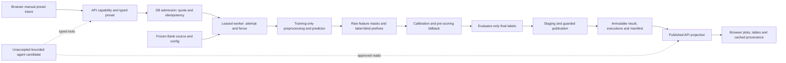

# SHIFTGUARD: gate history, product boundaries and system map

30 September 2026. Planning record; no new gate acceptance or application implementation.

## Current position

Gates 0–5 have been accepted. Gate 6 is an unaccepted working-tree candidate with **25 material blockers**. Gates 7–11 remain future work. Six of twelve numbered gates are accepted; that is a gate count, not a claim that half the engineering effort or production readiness is complete.

Application repository: `C:/Users/Abhinav Anand/Downloads/nvidia/shiftguard`. Current HEAD is `83037b0f02eef62203c3f565a063d824af2722d7`. The existing dirty candidate does not inherit acceptance from HEAD. Accepted Gate 5 source is `f63116fedc2751493d79d44897ba913b6d28b0b5`; its acceptance checkpoint is separate.

SHIFTGUARD currently tests how structured missing inputs affect a **frozen binary classifier's probability calibration** and recorded decision loss. Its available browser product is a Bank benchmark workbench. It is not yet an authenticated business upload service, a live production monitor, a deployment-certified SaaS, or a completed confirmatory research study.

## Historical sequence and acceptance

| Gate / period | Implemented behavior | Defects and correction history | Authoritative disposition |
| --- | --- | --- | --- |
| 0 / 11 September | Python package, CLI, settings, SQLite/PostgreSQL migration policy, FastAPI/static boundaries, React/Vite shell, container foundation | Version/runtime/profile, packaged/static and actual container checks established the foundation. A shell did not imply implemented experiments. | Accepted `a9d0aa0`; [foundation verification](../../../docs/aegis/work/2026-09-10-shiftguard-implementation/30-gate0-verification.md). |
| Research R1 / 15 September | Working methods/protocol paper, editable exports, bibliography and LinkedIn/professor brief | Public wording was corrected to distinguish a recorded development artifact from scientific acceptance. Export layout repaired. No external peer review, protocol lock, submission or empirical success was asserted. | Discussion draft approved; [research review](../../../research/REVIEW_RECORD.md). The dated status file is historical, not current software status. |
| 1 / 15 September | Bank identity, ten-feature preprocessing, deterministic split/seeds, frozen logistic baseline, metrics, immutable experiment and distinct execution audit | Extra Brier division invalidated an early artifact. Five review corrections covered training-only imputation/OHE, frozen clean input identity, physical byte hashes, predictor/preprocessor identity and append-only executions through migration 0003. | Accepted `6c4d682884aac8ddf0a7c1fdff94572ae322ac27`; [resumed verification](../../../docs/aegis/work/2026-09-10-shiftguard-implementation/32-gate1-resume-verification.md). |
| 2 / 16 September | History-block outage, full-pool masking, nested acquisition of 50 labels, source/target temperature and paired comparisons | Initial inverse-temperature extraction and acquired-only masking were invalid. Six corrections added prediction-time fallback, correct denominators, complete pool masks, context-bound identities, failure/immutability/firewall tests and historical exclusions. Further verifier corrections enforced actual booleans, UTF-8, shared SQLite reuse and failure-before-publication. | Accepted `937f33c5c0f96ca18c9e7e0a82769c430d71bfa1`; [final review](../../../docs/aegis/work/2026-09-10-shiftguard-implementation/34-gate2-review-verification.md), [artifact dispositions](../submission-evidence/gate2-artifact-status.json). |
| 3 / 16–17 September | Two predictors × five scenarios × five budgets × eight methods = 400 conditions; four persisted plot payloads; source-remasked/fraction-binned maps, cost loss and qualifications | FIX03 corrected source fallback object reuse; FIX06 corrected context/preimages, mask/prefix persistence and identifiable failures; FIX08 corrected MCAR naming/config and threshold-0.5 selection; FIX09 persisted comparison qualification; FIX10 progressively closed duplicate budgets, misbound conditions, incorrect deltas/costs/thresholds/confusion totals and copied decision rows. Candidate progression included `6657a8c`, `5592622`, `c11dc05`. Narrow verifier closure did not imply whole-codebase perfection. | Frozen development contract [here](../gate3-development-contract.md). Subsequently hardened scientific engine reproduced on accepted Gate 4 source `10170fe…`; [exact final evidence](../../../verification/gate4-closure/independent-review-20260925/FINAL_REVIEW.md). |
| H0–H3 / 17 September | Hardening of science, persistence, verifiers and packaging | A01–A12: Adult identity; recoverable publication; conflict-safe insertion; independent preimages/projections; immutable config; nested source MCAR; stable temperature; metric validation; packaged migrations; per-attempt evidence; governance; real contract/CLI coverage. | Final dispositions in [fix ledger](../fix-ledger.md), original [audit](../../../docs/aegis/reviews/2026-09-17-codebase-audit/REVIEW.md). |
| 4 / 17–26 September | Durable jobs, capabilities, two-job quota, leases/fences, cancellation, continuation receipts, atomic result publication/recovery, managed workers, API, installed package | Reviews #1–#6 exposed incomplete combinations of ownership, expiry, cancellation, migration continuity, recovery and truthful evidence. Local passes with missing PostgreSQL evidence remained blocked. Bounded contracts I01–I08 eventually replaced broad recurring claims. Final Sol findings corrected cancellation schedules, HTTP nondefault-seed/audit assertions, both legacy migration rows and direct-driver URL normalization. | Accepted **`10170feab3c16c5eb61153d57d9e5879ba5a6fd6`**; 339 cases, 27 guards, no required skips, affected Gate 2/3 reproduction and installed-wheel proof on both backends. [Final acceptance](../../../verification/gate4-closure/independent-review-20260925/FINAL_REVIEW.md). |
| 5 / 27–29 September | Approved preset runs, capability-bound browser jobs, retry/reload/cancel, cached results, four persisted plots, tables, provenance and fallback details | G5-R01: reduced cache projection dropped per-bin fallback details. G5-R02: auth rejection after successful bootstrap had no explicit reconnect. Corrections preserved accepted-job lost-response identity and business-error identity. | Accepted **`f63116fedc2751493d79d44897ba913b6d28b0b5`** after Astra xhigh review and parent source binding; [acceptance](../gate5-acceptance.md). Original [BLOCKERS](../gate5-review.md) stays historical. |
| 6 / 30 September | Offline bounded agent/provider/HTTP/browser candidate and migration 0009 | 18 Sol application blockers + seven parent blockers. Actual author passes omit relevant crash/replay/grounding cases. Normal full-suite collection fails; diagnostic importlib run is not acceptance. Scripted-provider behavior is not live evidence. | **REVIEW_FAILED_CORRECTIONS_REQUIRED**. [Consolidated review](../gate6-review.md), [application review](../gate6-sol-review.md), [complete correction batch](../gate6-corrections.md). No accepted Gate 6 commit. |

## Gate 4 correction families: what the repeated reviews actually repaired

| Findings | Underlying contract | Final behavior to preserve |
| --- | --- | --- |
| G4-01 | A manually called test worker did not prove a runtime service | Managed API lifespan worker/recovery and standalone CLI worker; HTTP acceptance reaches actual execution. |
| G4-02 / G4-03 / G4-05 | Mutation/publication paths had different authority checks | Current attempt/token/state/expiry/cancellation governs writes; publication/job/result/audit completion is one guarded DB transaction, with a recoverable filesystem gap. |
| G4-04 / R2-01 / R2-05 / R3-05 | Optional credentials and process-local locks bypassed admission | Server-issued capability, transactional per-session two-job quota, scoped idempotency, cross-session rejection and separate-connection/process evidence. |
| G4-06 / API-02 / R6-02 | A receipt or nonce alone did not preserve the dependency generation | Exact dependency-set CAS, durable replay response and single-winner continuation; new dependencies cannot silently disappear. |
| R2-02–04 / R3-01–02 / R3-04 / R3-06 | Recovery/finalization inferred ownership from unrelated IDs or old reads | Generation/job/execution/attempt/fence/content/lease are explicit; live owners protected, cancelled/failed jobs remain terminal, rejected transitions roll back. |
| R4-01 | Jobless CLI lease protection missing from recovery | Live CLI staging survives recovery; jobless is an explicit owner type. |
| R4-02 | Full-cycle ordering and caught exceptions committed orphan results | Decide recover versus requeue under authority; per-generation rollback/savepoint prevents partial records. |
| R4-03 / R6-03 | File hashes were confused with logical content/owner identity | Independently recompute stable digest and experiment prefix; reject partial owner context and malformed staged content. |
| R4-04 / A03 | SELECT then INSERT reintroduced conflict races | Targeted conflict-safe insert plus comparison of the winning full content/audit; distinct executions retained. |
| C01–C06 / SCI/API findings in review #5 | Owner predicates, cancellation reclassification, published listing, scientific and API semantics diverged | DB serialization; safe corrupt-record handling; expired-worker rejection; claim/cancel retry; one list entry per experiment; supported request reaches executed config. |
| G4-07 / R2-06 / API-04–06 | SQLite-only code and modified applied migrations hid compatibility failures | Portable SQL; canonical packaged revisions; forward upgrades with data/backfill preservation; explicit expired state and positive finite interval validation. |
| A04 / A10 / R6-04 / SCI-02 / SCI-07 / G4-08 | Passing producer metadata and overwritten reports were treated as proof | Independent gate-specific preimages and all projections, exact keys, immutable attempts, truthful status, source/report binding and separate acceptance checkpoint. |
| SG-SOL-01–04 | Last bounded counterexamples remained after broad local passes | Recovery cancellation schedules; authenticated seed-31002 request/result/audit; both old jobs after upgrade; direct PostgreSQL verifier URL handling. |

The detailed IDs, exact triggers, owning files and retained regression nodes remain in the original reviews and ledger. This table consolidates the history without reclassifying old author claims as independent proof.

## Frozen scientific contract

1. Bank source/clean bytes and row count are authoritative. The modeled features are `age, job, marital, education, default, housing, loan, pdays, previous, poutcome`; `duration` and all other columns are excluded. `unknown`, `pdays=999` and structural sentinels retain their declared meanings.
2. Bank roles are 55% predictor train / 15% source calibration / 10% target pool / 20% final evaluation: 22,653 / 6,178 / 4,119 / 8,238 records. Training fits preprocessing and predictors once. Calibration wraps the original frozen pipeline; it does not refit it or stack target calibration on a source-calibrated estimator.
3. Missingness operates on eligible originally observed raw cells before frozen preprocessing. Full pool masking precedes label acquisition. Prefix selection is label blind, nested and never redrawn for a one-class sample. Final labels stay evaluator-only. Pool/test random streams are distinct; paired methods use identical final rows and masks.
4. Source, target and sparse-bin fallback chains resolve before final scoring. Fallback is not a successful fit. Budget zero is unattempted, not a fit failure. Failed raw prediction gives null metrics/unavailable comparisons. Persist per-bin resolution and identifiable failed attempts.
5. Distinguish requested row probability, realized row/cell rates, eligible-group denominators, all-feature denominators and natural missingness. Preserve qualification flags and residual mismatches in both standalone and plotted comparisons.
6. Binary Brier is mean squared error under the declared half-scaled multiclass convention; log loss clips at `1e-15`; reliability has ten equal-width bins, including null empty bins. Decision threshold is `FP_cost/(FP_cost+FN_cost)` and decision loss is `(FP_cost*FP+FN_cost*FN)/N`. The fixed five cost pairs do not establish realized financial savings.
7. Scientific logical digest, physical artifact byte hashes and execution audit UUID/Git provenance serve different purposes. Condition identity binds dataset/evaluation/predictor/source map/masks/acquired IDs/fit parameters. Canonical UTF-8 serialization and DB-to-disk projection agreement must remain independent checks.
8. Development seeds do not establish an untouched confirmatory cohort. Adult official final outcomes remain sealed until the protocol lock. SCI-03 pool qualification and SCI-04 numerical policy remain explicitly deferred; a UI or business extension cannot silently redefine them.

Accepted Gate 2 experiment `c6678b6b4ddbc482c5bc4e81` records target adaptation versus outage-source **Brier +0.004136873913246311 and log loss +0.044964128881780974**: a harmful result, retained. This supports an evidence-inspection story, not guaranteed calibration improvement. Invalid/superseded experiments remain excluded by the artifact-status ledger.

## Current code owners and data flow

| Layer | Current owner paths, relative to application root | Change boundary |
| --- | --- | --- |
| Input identity/roles | `shiftguard/datasets/{bank,adult}.py`, `data/manifests/`, `protocol/{splits,acquisition}.py` | Business data needs a separate validated identity/role contract; never relax Bank/Adult identity. |
| Predictor input/model | `preprocessing/tabular.py`, `predictors/{logistic,random_forest}.py` | Benchmark models train internally; imported business models require a new frozen-inference adapter. |
| Missingness/calibration | `missingness/`, `calibration/`, `experiments/config.py` | Do not infer a customer's feature group from Bank history fields. |
| Science orchestration | `experiments/{runner,outage_runner,stress_runner,evaluator}.py`, `metrics/` | Three runners expose different supported analytical contracts; not interchangeable duplicate files. |
| Identity/publication | `experiments/{ids,artifacts,publication}.py`, `storage/repositories.py` | Current global result addressing is unsuitable for customer assets without a private namespace and authorized reads. |
| Runtime | `jobs/{queue,worker,recovery,continuation}.py` | Reuse proven authority laws; do not create a second permissive worker loop. |
| API | `api/auth.py`, `api/schemas.py`, `api/routes/` | Current capability session is demo authority, not business account/organization membership. Public published-result GETs need a separate private boundary. |
| Browser | `frontend/src/api/`, `hooks/useWorkbench.ts`, charts/components/App/styles | Python owns empirical numbers; browser preserves identities, projections and unavailable states. |
| Agent candidate | `shiftguard/agent/`, `api/routes/agent_requests.py`, `frontend/*Agent*` | Correct current 25 blockers before accepting or relying on these paths. No private raw data enters the provider. |
| Package/runtime checks | `shiftguard/migrations.py`, packaged `shiftguard/alembic/`, root CLI ini, Dockerfile, lockfiles | Applied revisions remain; redundant source copies can be consolidated separately. |
| Verification | `tests/`, `verification/verify_gate{2,3}_reproduction.py`, acceptance runner | Test files prove active contracts even when their names mention an old gate. They are outside runtime delivery, not obsolete engineering assets. |

## Gate 6: exact closure map carried forward

| Blocker group | Required correction |
| --- | --- |
| S01–S08 | Durable provider exchanges/intents/counters/repair limits; atomic side-effect admission under session/request authority; release WAITING lease; original call IDs and remaining calls; concurrent insert/read and issued-nonce receipt replay. |
| S09–S12 | Request-owned evidence authorization, validated explanation plan and deterministic rendering; typed errors/nulls; preserve failed/adverse/fallback/unqualified outcomes. |
| S13–S18 | Actual preset-worker binding, compatible comparison context/budget/condition selectors, executable semantic allowlists, safe metadata projection and bounded traces, authoritative job-bound terminal evidence. |
| P01–P02 | Session-bound persisted agent intent; real accepted-then-lost HTTP identity; WAITING reload/poll/resume recovery; explicit recognized capability reconnect, distinct provider/business errors. |
| P03–P04 | Enforce conservative per-wire/token budgets; complete exact-model canaries; no hidden retries or false overall PASS; typed bounded provider failures and known-secret removal. |
| P05–P07 | Normal test collection/current-head upgrades/installed package; actual-report-derived source-bound evidence; isolated scripted provider and truthful provider kind. |

Previous proof: author 34 agent / 12 browser / 5 static cases pass. Parent normal suite stops with three collection errors. Separate diagnostic importlib run: 372 pass, one migration-head failure, zero skips; it is not a normal-command acceptance. Sol's 58 probe assertions comprise 52 defect reproductions and six controls. Passing defect-reproduction assertions mean defects were demonstrated. Exact reports are linked in [Gate 6 review](../gate6-review.md).

## Next gates and independent product extension

| Track | Remaining outcome |
| --- | --- |
| Original Gate 6 | Correct offline contracts, independent source-bound review, then authorized exact-model live evidence; no automatic live call. |
| Gate 7 | Anti-hallucination/abuse evaluation, held-out live requests only after prerequisites. |
| Gate 8 | Locked statistical/confirmatory protocol and Bank execution; explicit scientific decisions. |
| Gate 9 | Frozen Adult confirmatory replication; no first-time protocol authoring at execution. |
| Gate 10 | Authorized hosted judge build, deployment and required operational checks. |
| Gate 11 | Submission/release freeze, clean reproduction, materials and public-release authority. |
| Frontend refresh | This run delivers Astra design and Luna instructions only; implementation is a separate bounded source batch. |
| Business BYO | A new private-product extension with separate acceptance IDs. It does not rename or declare original Gates 7–11 complete. |

## Source register and inspection limits

The read-only [history index](../../../verification/product-planning-20260930/history-index.json) catalogs dated gate/review/research/planning documents, their raw hashes, headings and finding lines. It is an inventory, not an assertion that every historical artifact was independently rerun. Primary gate verification, original review rounds #1–#6, hardening/complete/remediation reports, current contracts/ledger, final Gate 4/Gate 5 acceptance and Gate 6 reviews/corrections were inspected together with current dependency/owner paths and actual existing report summaries.

Full raw logs, all vendored dependency bytes and every frozen checkout file were not line-by-line re-audited. The [file inventory](../../../verification/product-planning-20260930/file-inventory.json) explicitly excludes runtime/vendor and installed evidence environments and records sixteen inaccessible directories. Historical acceptance/results quoted above are read from their records; no fresh application tests or builds are claimed by this documentation run. Research status from 15 September and older execution prompts remain dated history even where their “current” wording is now stale.
